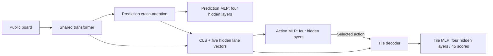

# PVZ plant research

Train a sequential Q policy against a pinned Plants vs. Zombies simulator. A
shared Transformer encodes the public board. An effect head predicts this frame's
untouched field, breach, and probe. Its five hidden lane vectors and the encoder's
first (CLS) vector form a six-token policy memory. An MLP chooses
Wait/species/Dig, and a conditional decoder scores all 45 tiles. Illegal cards
and cells are excluded before that choice: a plant needs sun, a finished
cooldown, and an empty cell; Dig needs a cell that already has a plant. Exact simulated
pre-action outcomes are auxiliary training targets. Validation uses the greedy
network on the public board.



## Requirements

Python 3.12, Git, the pinned game checkout, and an NVIDIA GPU with native BF16
support for training. Human recording and the native viewer also require pygame.

## Installation

```powershell
.\tools\bootstrap.ps1 -GameRepo E:\Projects\pvz-cuda-work
.\.venv\Scripts\python.exe -m pvz_rl doctor --output artifacts\availability.json
```

Linux/WSL or Git Bash:

```bash
bash tools/bootstrap.sh --game-repo ../pvz-cuda-work --python python3.12
```

Installers verify the [engine lock](src/pvz_rl/data/engine-lock.json) and leave the
engine checkout unchanged.

## First useful command

Record human gameplay into unused paths and finish with a natural win or loss:

```powershell
.\.venv\Scripts\python.exe -m pvz_rl record-demo `
  --output runs\human.pvzdemo --archive runs\human.jsonl
.\.venv\Scripts\python.exe -m pvz_rl initialize-demo `
  --archive runs\human.jsonl --replay runs\human.pvzdemo `
  --output runs\human-init --device cuda
```

Demo initialization verifies the replay before fitting. `--init-from` starts fresh
optimizer and counters from same-version weights; `--resume` restores a
same-version run. Checkpoints from earlier model versions are rejected.

Start autonomous training when ready:

```powershell
.\.venv\Scripts\python.exe -m pvz_rl train `
  --init-from runs\human-init\initialization.pt --output runs\my-run `
  --gpu 0 --gpu-profile rtx4070-laptop
```

Default progression is
`pre_prediction → prediction → cherry_bomb → cherry_bomb_obstacle → attacker_pre → attacker → easy → standard → shared`.
Use `--stage NAME --until-stage-complete` for one stage, or `--games N` for a
completed-episode budget. Explicit normal stages skip preliminary stages. Omit
`--init-from` to start with random weights.

Each stage can start from the previous stage's weights;
[pre_train.ps1](tools/pre_train.ps1) chains them in order:

```powershell
.\.venv\Scripts\python.exe -m pvz_rl train --stage cherry_bomb --until-stage-complete `
  --init-from runs\compact-stages\prediction\final.zip --output runs\compact-stages\cherry_bomb `
  --gpu 0 --gpu-profile rtx4070-laptop
```

`pre_prediction` forecasts only the opening frame. Its isolated target resolves
only zombies already present, suppresses scheduled spawns, then probes the settled
surviving defenses. Each scene contributes one forecast and one exact target job.
It trains only the encoder and prediction head; all 15 classes must match for a
scene to count at its inclusive `env_success_threshold = 1.00`. `prediction`
keeps its strict threshold and forecasts until first house entry or a quiet board.
Initialize it from `pre_prediction/final.zip` when chaining stages.

For a capacity check from fresh weights, recollect the same 640 scenes and fit
exactly one pass between checks until all 640 forecasts are fully correct:

```powershell
.\.venv\Scripts\python.exe tools\overfit_pre_prediction.py --seed 101 `
  --output runs\diagnostics\pre-prediction-overfit --gpu 0 --gpu-profile rtx4070-laptop
```

The control checks opening/target hashes, logs separate target losses and missing
labels in `overfit-metrics/`, and saves the first 100% weights without another
update. `overfit-state.json`, `overfit-config.json` and `scene-seeds.json` remain
beside the weights. Resume with the same command plus
`--resume runs\diagnostics\pre-prediction-overfit\interrupted.zip`.
It has no time ceiling; Ctrl+C saves recovery. Live controls are disabled.

`pre_prediction`, `prediction`, cherry bomb, cherry-bomb obstacle, attacker pre, and attacker
take one fitting pass per cohort. Each cohort is scored once before that pass,
and the pass still runs when the score is already perfect. The fitting line
shows that score as an integer ratio, such as `612/640`, and `streak k/10`.
On prediction the same line also prints `forecasts N/M`. The report charts the
check from before the first fitting pass for these six stages. Prediction draws
successful environments and fully-correct forecasts. The charts redraw every 10
cohorts and when a stage advances, and do not chart exploration for them.
Episode rows are written at that same refresh. A checkpoint that omits the
before-fit pair or the forecast pair still resumes. When the open cohort has
not committed a pass, the finished first check is that point; otherwise the next
cohort records it. Both forecast stages now require fresh collection runs;
same-architecture `--init-from` remains supported. They draw defeated, on-field
and count-only unspawned zombies. Unspawned zombies affect the public total but
have no schedule and never enter the field. On-field zombies occupy random
positions across all five lanes and nine columns. Their remaining body HP plus
armor follows `zombie_hp_fraction`: a normal distribution centered at 80%, with
10 percentage-point standard deviation, resampled outside 1–100%. Damage consumes
armor first. The count of on-field plus unspawned zombies retains the exponential
weights 0.1 at one and 0.01 at ten.

Both forecast stages score and fit every recorded forecast. Gameplay keeps the
first of each pair of repeated Waits within a single Wait interval; spawning,
accepted planting/Dig, and episode boundaries restart pairing, while deaths do
not. Reports include raw and retained row counts. TD bootstraps use the highest
legal online branch and that same branch's EMA value. A pending exploration card
executes Wait until it can be planted. These collection/fitting corrections require
fresh runs; same-architecture portable weights still support `--init-from`.

Prediction records a forecast every 10 ticks until the first actual house entry
after mower resolution, or the quiet-board stop if no entry occurs. The crossing
step ends at that exact simulator tick. It retains
the forecast before the crossing step and makes no further model calls for that
environment. One exact private continuation completes the remaining fight,
settles surviving defenses and runs one probe. Every earlier forecast receives
the full episode's shared static result and probe, including later breaches in
other lanes. An already quiet opening records one forecast. The cutoff publishes
no label. The environment succeeds when
strictly more than 95% of its scored forecasts are fully correct. The cohort
succeeds when all 640 environments succeed. The four placement stages count a
board when the greedy legal tile is in its labeled successful set. A stage
advances after 10 consecutive full cohorts meet that bar: prediction when every
environment succeeds, obstacle, attacker pre, and attacker at 100%, cherry bomb
strictly above 0.95. Easy, standard, and shared require every game of each of
their tasks to be won, and every required task has to occur. Training does not
run a held-out panel. The live view draws the three bands and hides action
scores that were not recorded. Both forecast stages train the shared board encoder and
effect head, and its forward stops there. Later stages freeze both and still
run them. The teacher on
every stage uses EMA decay 0.99. Placement trains and runs the tile decoder and
tile head. Easy, standard, and shared also train and run the action MLP. It
normalizes and concatenates the six vectors; the tile decoder reads those six
vectors with action-conditioned coordinate queries. The forecast reads the
full encoder memory before the action is
chosen. Use the prediction `final.zip` to initialize `cherry_bomb`.

Across stages, a probe starts once the field clears, queued shots fire and their
projectiles clear, moving mowers finish, and surviving Chompers are ready. The
static-field **H** cell is 1 when the predicted field class is home. Start fresh
with `shared_public_outcomes_q_v13` and use its checkpoints for `--resume` and
`--init-from`. Earlier architectures cannot resume or initialize this model.

`attacker` mixes the three placement exercises in shuffled 640-board cohorts
(64 Cherry Bomb, 256 Obstacle, 320 Attacker Pre). Its stage bar is the same
labeled-set check as the other placement stages. Easy can start from
`runs\compact-stages\attacker\final.zip`.

Resume an interrupted stage from its recovery checkpoint:

Same-version Prediction recovery records house exits separately from actual
kills and restores the original physical state, kill counts and fitting progress.

```powershell
.\.venv\Scripts\python.exe -m pvz_rl train --stage cherry_bomb_obstacle --until-stage-complete `
  --resume runs\compact-stages\cherry_bomb_obstacle\interrupted.zip `
  --output runs\compact-stages\cherry_bomb_obstacle
```

No seed is required; `--seed` optionally fixes initialization. Start a new run:
attention widths are each group's heads times `head_dim`. Every MLP has
`policy.mlp_hidden_layers` hidden layers (four by default), followed by its output
layer. Board FFNs use 128 hidden units; prediction and tile FFNs use 96; the
action MLP uses 128; tile scoring uses 48. Set these widths in the corresponding
policy groups in [train.toml](src/pvz_rl/data/train.toml). The live view's gradient field
scales the next cohort's update. Its max field
sets that cohort's clip; the file default stays `max_grad_norm`. Its `3×` control
arms the next cohort at `learning_rate_restart` times `learning_rate` for one
pass. The cohort line prints each pass's gradient norm before that clip. A
checkpoint of this model that omits the scale, the max, those norms, or the
restart flags stays at 1, `max_grad_norm`, and idle, and records later passes. The three normal stages each have a
fitting pass count unless that restart is armed. Tune those passes, the loss
weights, and the execution settings in [train.toml](src/pvz_rl/data/train.toml);
each setting is commented there. Separate evaluation commands keep their panels.
Completed runs keep portable `final.zip` weights and visualizations;
unfinished runs keep recovery checkpoints. A run's JSONL logs roll at 5 MB
into a folder per log, such as `hardware-metrics/`. On the next open, a file
already larger than that is moved into the folder and later records go to a
new file there.

## Common checks

```powershell
.\.venv\Scripts\python.exe -m pytest -q
.\.venv\Scripts\python.exe -m pytest -q -m learning
.\.venv\Scripts\python.exe -m pvz_rl replay runs\human.pvzdemo --watch --speed 2
.\.venv\Scripts\python.exe -m pvz_rl visualize --run runs\my-run --report-only
```

The smoke tests check that the workflow runs, not that the agent masters a stage.
For throughput work, the [easy-stage collection benchmark](tools/benchmark_peashooter.py),
[workflow profiler](tools/profile_training_workflow.py) and
[timeline tool](tools/draw_collection_process.py) document their options in `--help`.

- [Code structure and test ownership](AGENTS.md)
- [Architecture and workflows](docs/architecture.md)
- [Research references](docs/references.md)
