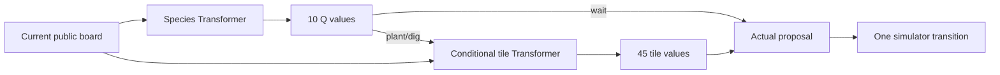
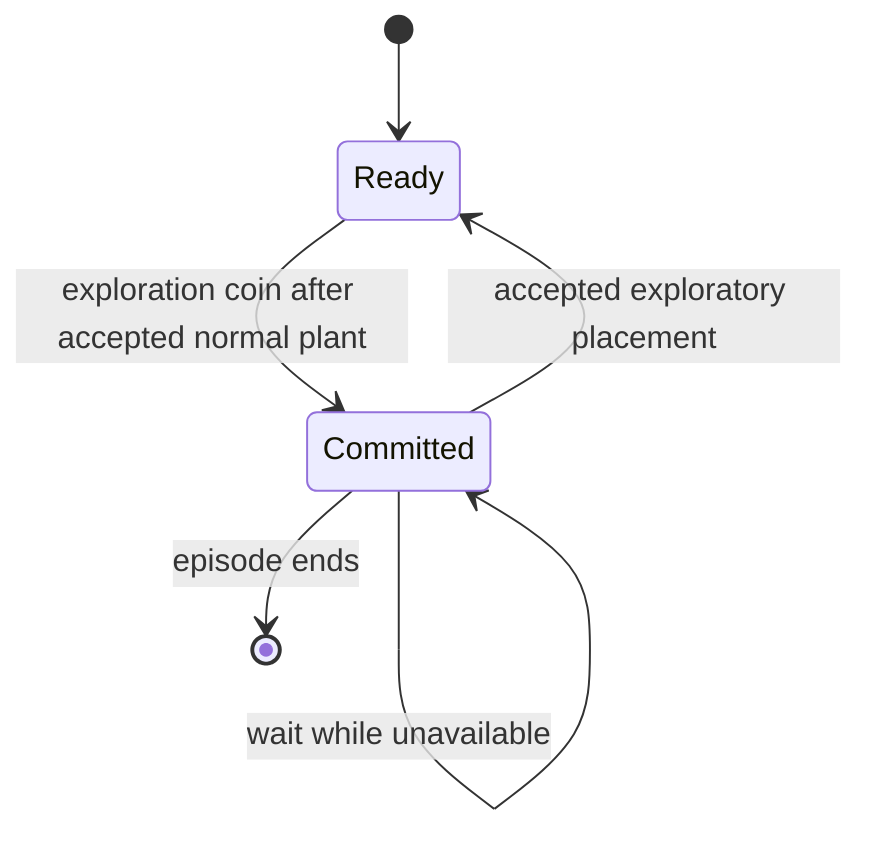
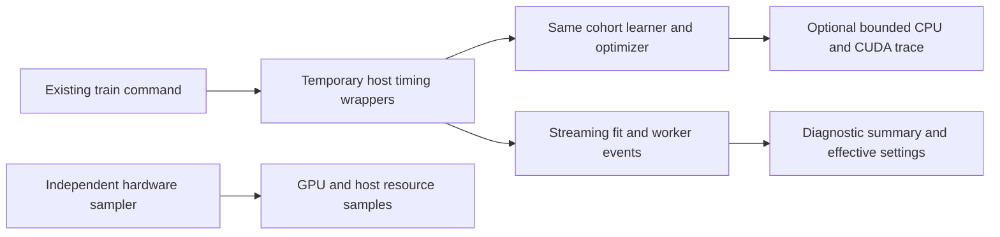
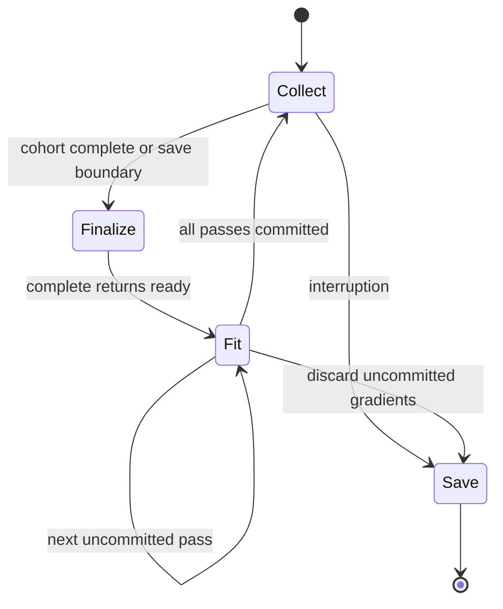

# System architecture

The project trains a stateless two-stage Q policy against a pinned CUDA
simulator. Every decision reads the current public board; no LSTM, event memory,
frame stack or counterfactual simulator is part of the policy or collector.

## Responsibilities

| Area | Responsibility |
|---|---|
| Environment adapters | Public entities, timing, action outcomes and reward ledgers |
| Two-stage policy | Species/wait/dig Q values and conditional tile Q values |
| Exploration controller | Tile randomness and persistent alternative-species commitments |
| Cohort learner | Collection, complete returns, balanced losses and EMA updates |
| Storage/transport | Canonical rows, ragged entities, RAM/disk spill and prefetch |
| Checkpoints | Contract validation, FP32 masters, BF16 EMA and atomic recovery |
| Monitoring/presentation | Host-side progress, diagnostics and read-only journals |

Seeds, schedules and simulator snapshots stay in execution state and never enter
policy inputs. `src/pvz_rl/data/train.toml` is the sole parameter source.

PowerShell and Bash bootstrap tools install the same pinned CUDA environment.
They share archive/hash verification, install the game non-editably and never
change its checkout. A missing commit or mismatched manifest fails installation;
the Bash entry point removes its temporary source archive even on failure.
See [installation](../README.md#installation).

## Decision flow

The species stage has width 128, four layers and eight heads. The tile stage has
width 192, six layers and twelve heads. Their parameters are independent. The
tile stage receives the selected branch, the same current board and 45 spatial
queries. Plants use empty tiles, dig uses all tiles, and a full-board plant
keeps the tile-zero rejection fallback. Sunlight and cooldown do not hide
branches. A rejected action records its proposal and advances one tick; an
accepted plant or dig advances zero ticks.

Both stages run with BF16 parameters and activations during collection,
evaluation, demonstrations and fitting. The online policy keeps unregistered
FP32 master parameters, and Adam owns only those masters and FP32 moments.
After each committed fit pass, masters are copied to the BF16 runtime model and
the BF16 EMA teacher is updated. Checkpoints serialize FP32 online masters,
FP32 optimizer state and BF16 EMA state.

## Exploration and collection

Tile exploration decays from 50% to 1%, and accepted normal planting can start
a uniformly selected alternative-species commitment from 10% to 1%. Both
schedules decay over 10,000 stage games, remain fixed within a cohort and reset
on stage changes. Commitments issue ordinary waits until the species is
affordable, cooled down and placeable. Successful committed placements clear the
commitment; they do not recursively trigger another commitment.

An active-batch plan packs unfinished original slots into public-width buckets,
then restores results to canonical slots. Finished slots are inactive and never
refilled. Padding carries no state, RNG, supervision or storage evidence. Real
environments continue immediately after planting: there is no probe queue,
source bank, auxiliary lane or post-plant drain.

## Learning and storage

Every actual decision is appended with its public observation, proposed action,
acceptance, duration, reward, exploration provenance and stable original slot.
Complete returns are computed chronologically per episode, while inactive slots
and capacity gaps contribute nothing. Width-bucketed flat batches are prefetched
through the existing double buffer and reused across all fitting passes; padding
is excluded from losses and denominators.

Compiler caches and CUDA captures belong to individual encoders. Fitting uses
phase-local code objects and bounded static shapes; collection uses its separate
LRU. Quiescent phase changes release fitting captures and renew only the owner's
compiler cache, without changing global limits or policy inputs.

Wait values regress against the complete remaining return through the species
stage. Plant and dig values regress only the actual proposed tile through the
conditional stage. Species consistency selects a geometry candidate with
detached online tile values and evaluates that selected tile with the frozen
BF16 EMA tile stage. Its MSE-matched Huber loss updates only the species stage.
Accepted/rejected and wait/plant/dig weighting uses whole-cohort denominators.
Four autonomous passes and twenty demonstration passes commit one optimizer
step per pass, then update the EMA with decay 0.95.

## Optional fitting diagnostics

The diagnostic script in `tools/` forwards the normal training arguments and
records fitting startup, CPU preparation, compilation/capture, loss/backward
and weight updates without replacing any training operation. Chunk metadata
uses host records and tensor shapes; the lightweight path issues no new CUDA
events or waits. The existing independent hardware sampler accepts optional
host detail collection for thread CPU, process I/O and container quotas.
Raw samples/events stream to a separate unused directory, with a bounded set
of slow chunks in the summary. Temporary wrappers are restored on exit.

The optional profiler captures one finite window counted by fitting data batches.
It can perturb execution and add synchronization, so its trace explains the
timeline while lightweight samples describe ordinary utilization. Unsupported
resource facts and trace failures are reported without dropping samples or
changing fitting. Host spans overlap and CUDA-event pass duration includes idle
gaps; neither is an estimate of GPU busy time. See the
[diagnostic workflow](math/training-throughput.md#diagnose-cloud-fitting-stalls).

## Recovery and failures

Saving and interruption preserve only coherent actual-game state. An unfinished
fit pass discards gradients; a committed pass is never repeated. Runtime maps,
prefetch workers, fitting spools and graph captures rebuild after recovery.
BF16 support is checked before simulator allocation. Nonfinite BF16 loss or
gradients fail explicitly; only bounded memory reductions may retry. Old
probe-enabled, FP32-runtime, partial-BF16 and incompatible contracts are
rejected before allocation. There is no migration path.

Demonstration replay verification checks historical facts and reprices rewards
under current settings without rewriting recordings. Evaluation disables both
exploration mechanisms and performs no fitting. Curriculum mastery probes are
evaluation controls only; they are unrelated to counterfactual gameplay.
