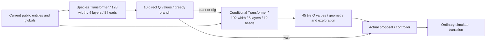
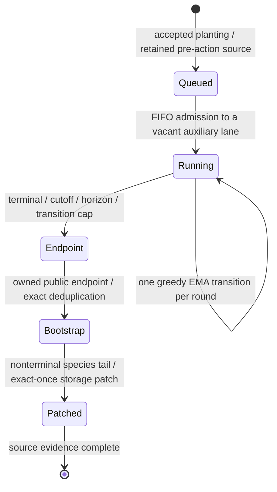
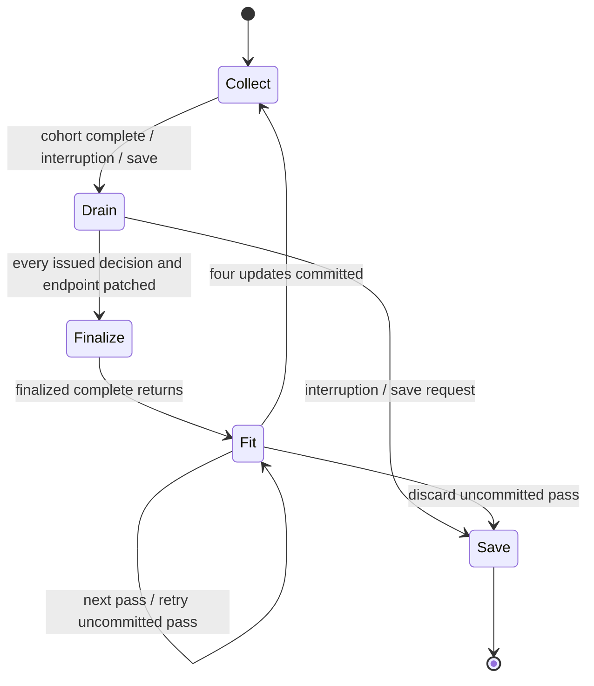

# System architecture

A stateless two-stage Transformer Q policy supports human initialization,
autonomous collection and evaluation on a separate, pinned 100 Hz simulator.
Both networks read only the current public board; there is no learned history.

## Boundaries and responsibilities

The bundled training profile is the sole parameter source. Fresh runs use
current defaults. Current-contract resume retains learning/reward settings and
refreshes execution/logging controls. Previous weights and recovery fail before
simulator allocation; there is no migration or historical collector.

| Component | Responsibility and owned data |
|---|---|
| Environment adapters | Public boards, action outcomes, timing and reward ledgers |
| Two-stage policy and runner | Direct species Q values and requested conditional tile Q values |
| Exploration controller | Persistent species commitments, separate from the model |
| Scheduler and probe pool | Retained decisions, immutable sources and independent auxiliary games |
| Cohort learner | Complete returns, EMA consistency, balanced losses and whole-pass updates |
| Storage and transport | Canonical slots, ragged entities, RAM/disk spill and exact-once patches |
| Checkpoint inspection/recovery | Contract validation and atomic execution/model restoration |
| Monitoring/presentation | Host-side reports, read-only journals and viewer snapshots |

Private simulator snapshots, seeds and schedules are execution/recovery data,
never model inputs. Reward accounting is retained, not a learned memory stream.

## Current-board decision flow

Each board contains individual mowers, plants, zombies and projectiles, plus
resource, elapsed-time, cooldown and population globals. Normalization and the
256-entity cap are shared. Globals count entities before truncation, and omission
diagnostics disclose information lost above the cap. Attention is invariant to
entity permutation within numerical tolerance.

The species network uses one global readout token. The tile network independently
embeds the same raw board, one global token, the requested branch and 45 spatial
queries. It receives no species-network features or scores. Discrete branch
selection carries no gradient between stages; no scalar bypass or fusion exists.
Only requested board/branch pairs are scored, reusing duplicates within a call.
Wait requires no tile inference.

Normal selection compares all ten species/wait/dig scores. Plants choose empty
tiles; dig considers all tiles. Full-board plants keep tile-zero rejection
fallback. Resources and cooldown never hide ordinary branches.

Accepted planting/digging takes zero ticks; waits and rejected proposals advance
one tick. Storage retains the actual proposal, acceptance, execution, duration
and reward. Separate zero-time decisions retain their order.

After accepted normal planting, an exploration coin can commit to another
species. The controller issues ordinary waits until resources, cooldown and
geometry permit it, without a timeout. Successful exploratory planting clears
the commitment without recursively drawing a new coin. Its requested tile values
come from the current board. Original policy proposals remain diagnostic.
Both exploration schedules freeze per cohort and restart on stage promotion.

See [entity inputs](math/entity-inputs.md), [selection penalties](math/invalid-action-penalties.md)
and [the objective](math/sequential-training.md) for field definitions and math.

## Background placement comparisons

Every accepted actual planting, normal or exploratory, creates up to four probes
of the same species on distinct other empty tiles. Waits, digs, rejected plants,
initial plants and auxiliary plants never trigger probes. Separate zero-time
placements remain separate jobs; there are no alternative-species probes.

Before eligible execution, a pinned read-only legality mask gates reservation of
an immutable pre-action simulator/accounting source. This execution-only mask
does not replace policy geometry. Actual acceptance authorizes the alternatives
and advances deterministic tile-selection cursors without behavior RNG.

Scheduler rounds advance ready real slots, then occupied auxiliary lanes. Real
games, including the planting owner, continue before probes finish. Defaults are
256 active lanes, 128 outstanding source jobs and one auxiliary transition per
round. Capacity pressure holds only a slot whose next eligible planting cannot
be retained, preserving its selected action/draws and simulation time. Older
held decisions receive admission first; blocked slots are not completed games.

Forks follow frozen greedy EMA without exploration or recursive probes. Stops
are true terminal/cutoff, 30 simulated seconds or 4,096 transitions including the
initial alternative. Horizon/cap stops bootstrap with maximum EMA species Q;
true terminal/cutoff stops do not. Limits fabricate neither waits nor defeat.

Vacant allocation rows execute nothing. Headroom/budget fallback reduces source
and lane capacities to one without dropping alternatives; minimum failure is an
explicit error. Independence removes the rollout barrier, not GPU contention.
Auxiliary rewards and states never enter actual gameplay or count as cohort games.

Endpoints own public boards, reward components and initial-action evidence before
lane reuse. Exact endpoint-input/EMA-version dedup saves bootstrap work only;
ongoing simulations never merge. Conditional requests also compare branch.
Each proposal/outcome remains a separate supervision record. Heavier control
reporting occurs every 64 continuation rounds.

## Cohort learning and storage

Up to 128 games form a fixed-weight cohort. Finished slots are not refilled.
Active plans compact boards and restore canonical slot identities; padding has
no episode state, RNG or supervision. Species/tile encoders use separate token
overheads (1/47), active buckets and owned graph caches.

Actual rows append immediately with stable identities and pending probe counts.
Later handoffs patch endpoints exactly once in RAM or spilled storage. Reusable
pinned views are consumed before reuse. Trajectory slabs, staging, retained
decisions, source/lane workspaces, EMA and endpoints share memory accounting.

Reward finalization waits for all evidence. Development applies early Sunflower
bonus and dense scaling once; victory-time shaping uses the actual cohort's
duration median for actual games and probes. Complete actual returns remain
chronological per episode, even across capacity gaps.

Flat fitting includes only active decisions. Wait regression trains the species
wait output; plant/dig regression trains the actual conditional tile. Species
consistency trains only the first network toward detached frozen-EMA candidate
tile maxima. Balanced probe Huber trains the initial alternative tile. Bad
sampled tiles therefore do not directly regress species toward their return.

Each pass accumulates whole-cohort gradients using global group/outcome counts,
clips once and commits one Adam update. Then both EMA networks update with decay
0.95. Autonomous training uses four passes; demonstrations use twenty. Batches
are flat, with no recurrent state or temporal detach boundaries. Four-batch
execution grouping does not create additional optimizer steps.

## Recovery and failure paths

Saving stops new selection, finishes issued tickets and drains probes, bootstrap
copies and patches. No unfinished evidence or transient fork is serialized.
Atomic replacement couples weights, EMA, optimizer, counters, curriculum, RNG,
simulator/accounting, commitments, scheduler/cursors and trajectories. A failed
save leaves the preceding checkpoint intact. Recovery rebuilds compact maps,
auxiliary pools and caches; committed updates are not repeated.

Collection/fitting captures have separate phase owners. Quiescent transitions
drain transfers and release outgoing resources. Cache/headroom/capture failure
uses exact eager inference. Nonfinite/failed uncommitted fitting passes discard
gradients before bounded precision/allocation retry; exhaustion commits nothing.
See [execution controls](math/training-throughput.md).

## Demonstrations, evaluation and observability

Demonstrations verify archive/replay facts, outcomes and timing, then reprice
rewards without modifying recordings. They fit the same separated losses plus
accepted branch/tile preferences, with EMA for both networks; no probes run.
Evaluation uses the stateless runner without exploration, probes or updates,
and CUDA traces are checked against CPU replay. Curriculum uses held-out gates.

Viewers/journals are read-only. Host reports show current-cohort wins/returns,
interval active throughput, auxiliary queues/backpressure/drain, workspace use,
both-stage timing, selected-action and consistency errors, and conditional
best-tile minus sampled-tile placement gap. Detailed telemetry crosses existing
handoffs, not additional hot-loop device synchronization.

[Training](training.md) owns commands, [validation](validation.md) test ownership,
and [iteration history](iteration.md) measured results. Correctness controls are
not evidence of mastery or guaranteed speed/win-rate improvement.
