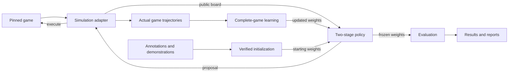
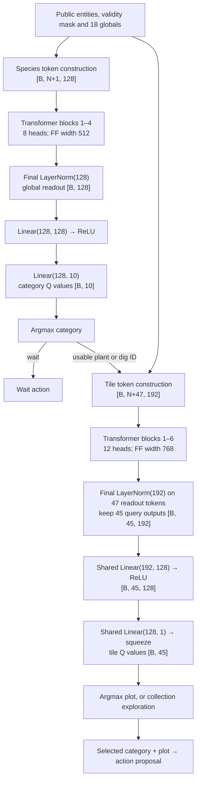
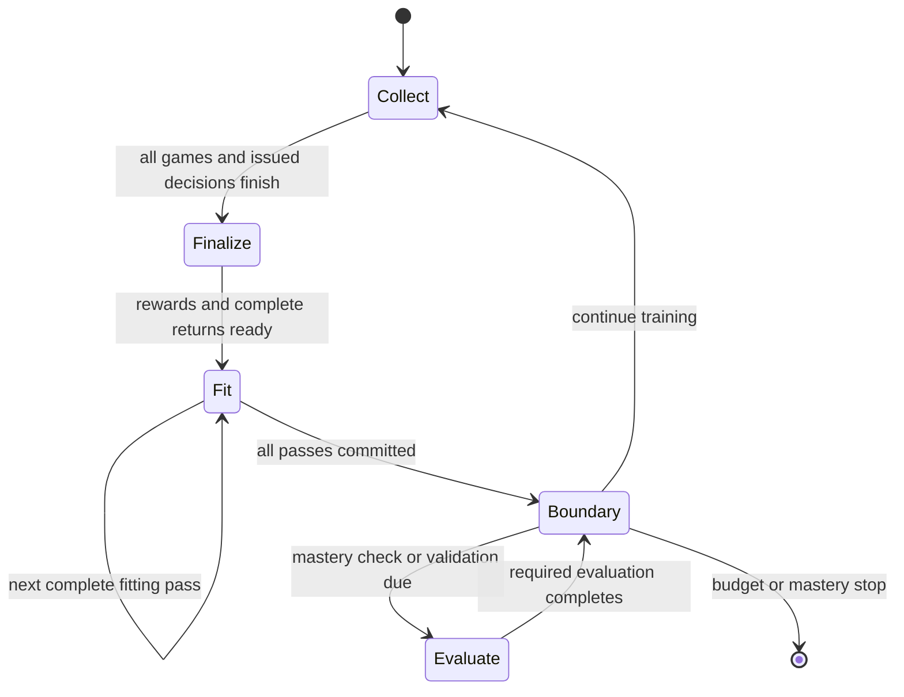
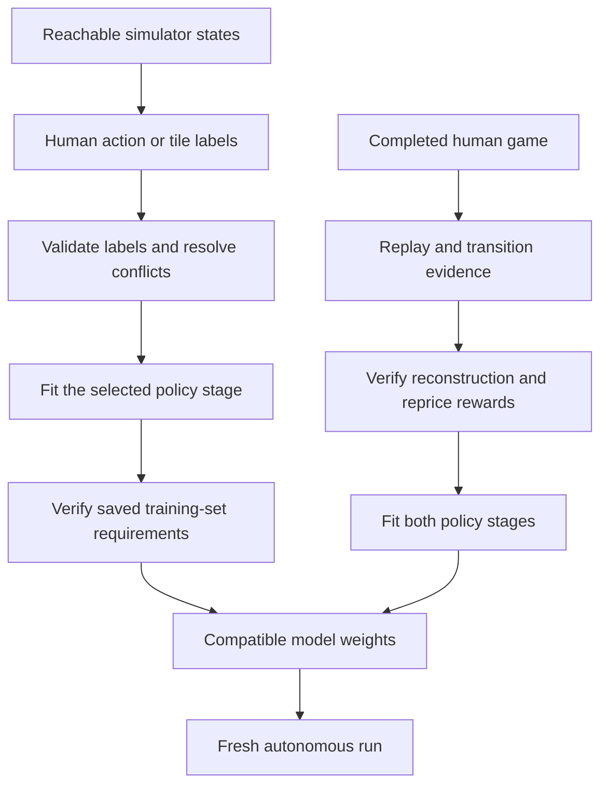

# System architecture

This project learns plant placement in a pinned Plants vs. Zombies simulator.
It has one stateless two-stage Transformer Q policy and one autonomous learning
framework. Human annotations and verified demonstrations provide optional
starting weights for that same policy.

The project owns learning, reward interpretation and experimental evidence.
The separately installed game owns combat, legal actions and game rules.
Autonomous learning requires an NVIDIA GPU with native BF16 support; CPU
simulation supports annotation, recording, baselines and reference checks.

## Project framework

| Component | Responsibility |
|---|---|
| Simulation and public-state boundary | Execute proposals, expose the current board and report actual outcomes |
| Policy and exploration | Choose an action category and location, with controlled exploration during collection |
| Complete-game learner | Turn finished trajectories into targets and update the shared policy |
| Human supervision | Collect reachable-state labels and verified games, then produce compatible starting weights |
| Experiment control | Resolve settings, manage curriculum and budgets, validate progress and recover interrupted runs |
| Evidence and presentation | Preserve provenance, evaluate frozen policies, report results and display actual gameplay |

The interaction loop produces actual experience; the learning loop consumes
completed games. Human supervision feeds the same model through initialization.
Evaluation uses frozen weights and supplies evidence rather than training data.
Experiment control coordinates these workflows, while viewers observe them.

A single [training configuration](../src/pvz_rl/data/train.toml) defines the
bundled model, learning and task settings. A run resolves its configuration
before execution and records the effective settings with provenance. Hardware
profiles adjust execution without defining a different policy or objective.
The game dependency is installed from a verified source pin, and its installed
sources and rules are checked before experiments.

## What the policy knows and decides

The policy sees only the current public board: plants, zombies, projectiles,
mowers, resources, card cooldowns and public progress counters. A shared encoding
presents individual entities and global facts to both stages. Entity storage is
bounded; truncation is reported, and transport padding carries no information.

Seeds, future spawn schedules, simulator snapshots, source identities and reward
ledgers remain private execution data. Annotation provenance and viewer history
also stay outside model inputs. The policy has no learned memory between
decisions.

The first stage predicts values for wait, each plant species and dig. The
independent second stage receives the chosen non-wait category and the same
board, then scores the 45 plots. Both stages share the public representation
but have separate learned parameters. The first stage predicts category values
directly; it does not run every possible placement to choose a category.

The simulator remains the authority on whether a proposal succeeds. Resource
and cooldown restrictions do not remove categories from ordinary policy
selection, and placement considers occupied plots as well as empty ones.
An impossible category can skip placement inference while preserving its
rejected proposal. This lets learning distinguish a poor category choice from
a poor location within an available category.

Accepted planting and digging change the board without advancing combat time.
Wait or rejection advances one tick; rejection executes wait while retaining
the proposed action and reason. Collection may explore locations or maintain a
commitment to another plant species until it can be placed. Evaluation disables
these exploration mechanisms.

## Agent model architecture

The configured `two_stage_transformer_q_v1` agent has an action-category
(species) network followed by a conditional tile network. Each stage learns
its own embeddings, Transformer blocks and Q head. The tile stage receives
the selected category ID and the public board; species hidden features stay
inside the species stage.

### Inputs and token construction

In the shapes below, `B` is the batch entering a stage and `N` is its padded
entity width, capped at 256. Each board has its own retained entity count
`n <= N`. The tile batch contains only requested board/category pairs.

| Input | Shape and type | Contents |
|---|---|---|
| Entity records | `[B, N, 11]`, int32 | `type`, `state`, `row`, `x`, `health`, `armor`, `phase_ticks`, `slow_ticks`, `has_pole`, `headless`, `damage` |
| Entity validity | `[B, N]`, boolean | Identifies retained entities and excludes transport padding |
| Global facts | `[B, 18]`, float32 | Sun, elapsed time, current wave, total waves, initial zombies, defeated zombies, eight card cooldowns, and plant/zombie/projectile/mower counts |
| Selected category, tile stage only | `[B]`, int64 | One plant category (1–8) or dig (9) per requested board |

The first two entity fields are categorical. The other nine are numerical:
row and position use board coordinates; health and armor use pinned maximum
values; countdowns use the tick rate; flags stay binary; projectile damage
uses normal-pea damage. Global facts arrive normalized. See the
[input contract](math/entity-inputs.md) for the exact scales and retention order.

Each stage constructs tokens as follows, with `d = 128` for species and
`d = 192` for tiles. `Linear(a, b)` includes a learned bias.

| Token path | Intermediate layers | Result |
|---|---|---|
| Entity type | `Embedding(17, d)`: 16 public entity types plus index 0 | `[B, N, d]` |
| Entity state | `Embedding(20, d)`: 19 namespaced public states plus index 0 | `[B, N, d]` |
| Entity numerical fields | Normalize nine fields → `Linear(9, d)` | `[B, N, d]` |
| Combined entity | Sum type, state and numerical vectors → `LayerNorm(d)` → zero padding | `[B, N, d]` |
| Global token | `Linear(18, d)` → insert token axis | `[B, 1, d]` |
| Category token, tile stage only | `Embedding(10, 192)` → insert token axis | `[B, 1, 192]` |
| Spatial queries, tile stage only | 45 fixed nine-field vectors → the tile encoder's `Linear(9, 192)` → add learned tile marker → repeat across batch | `[B, 45, 192]` |

Type/state embedding index 0 has a fixed zero vector; projectiles also use
state 0. The validity mask distinguishes present entities from padding.
Each spatial query has only normalized row and tile-center x populated in
its nine-field vector. It shares the numerical projection with tile-stage
entities and receives the learned marker directly. The input LayerNorm
above applies to combined entity tokens.

### Stage-by-stage layers

The species sequence is `[global, entities]`. The tile sequence is
`[global, category, 45 spatial queries, entities]`. Both use bidirectional
self-attention over their complete sequence, with padding masked out.

This diagram follows an ordinary usable non-wait proposal through both
networks. Wait ends at the species stage. An impossible selected category
skips tile inference and retains a rejected proposal, as described above.
Spatial queries participate in every tile self-attention block alongside
the global, category and entity tokens.

| Stage | Sequence through every block | Stack | Final readout and head |
|---|---|---|---|
| Species | `[B, N+1, 128]` | 4 independent blocks; 8 heads × 16 features; feed-forward width 512 | Global token → `LayerNorm(128)` → `Linear(128, 128)` → ReLU → `Linear(128, 10)` → `[B, 10]` |
| Conditional tile | `[B, N+47, 192]` | 6 independent blocks; 12 heads × 16 features; feed-forward width 768 | First 47 tokens → `LayerNorm(192)` → retain 45 spatial queries → shared `Linear(192, 128)` → ReLU → shared `Linear(128, 1)` → squeeze → `[B, 45]` |

Every block has its own parameters. The tile head applies the same two
linear layers independently to each spatial query. All dropout is zero.
There is no entity-list positional embedding; spatial information comes
from public coordinates and the fixed query coordinates.

### Inside every Transformer block

Let `L = N+1` for species and `L = N+47` for tiles. Each block preserves
`[B, L, d]`. The following operations run in this order in every block:

| Step | Operation | Species intermediate shape | Tile intermediate shape |
|---|---|---|---|
| 1 | Save input residual `x`; pre-attention `LayerNorm(d)` | `[B, L, 128]` | `[B, L, 192]` |
| 2 | Joint query/key/value projection `Linear(d, 3d)` | `[B, L, 384]` | `[B, L, 576]` |
| 3 | Split Q/K/V and reshape into heads | Each `[B, 8, L, 16]` | Each `[B, 12, L, 16]` |
| 4 | Attention scores `QKᵀ / sqrt(16)` | Logical `[B, 8, L, L]` | Logical `[B, 12, L, L]` |
| 5 | Exclude padded keys; softmax over key positions | Logical `[B, 8, L, L]` | Logical `[B, 12, L, L]` |
| 6 | Attention-weighted sum of V | `[B, 8, L, 16]` | `[B, 12, L, 16]` |
| 7 | Concatenate heads | `[B, L, 128]` | `[B, L, 192]` |
| 8 | Attention output projection `Linear(d, d)` | `[B, L, 128]` | `[B, L, 192]` |
| 9 | Add saved input: `y = x + attention_output` | `[B, L, 128]` | `[B, L, 192]` |
| 10 | Pre-feed-forward `LayerNorm(d)` on `y` | `[B, L, 128]` | `[B, L, 192]` |
| 11 | Feed-forward expansion `Linear(d, ff)` | `[B, L, 512]` | `[B, L, 768]` |
| 12 | GELU | `[B, L, 512]` | `[B, L, 768]` |
| 13 | Feed-forward contraction `Linear(ff, d)` | `[B, L, 128]` | `[B, L, 192]` |
| 14 | Add second residual: `z = y + feedforward_output` | `[B, L, 128]` | `[B, L, 192]` |
| 15 | Zero padded entity positions | `[B, L, 128]` | `[B, L, 192]` |

Attention computes `softmax(QKᵀ / sqrt(16) + mask) V`; the mask excludes
padding and permits attention in both directions. Global/category/query
tokens remain valid even on an empty board. The score/softmax shapes are
logical: efficient attention can avoid materializing the full matrices,
and the exact fallback chunks queries. Both implement the same operation.
Runtime weights and features
use BF16, with FP32 embedding accumulation and stable LayerNorm reductions;
training maintains FP32 master weights.

### Outputs and action selection

The species outputs are ten unconstrained Q values in this order:
wait, Sunflower, Peashooter, Wall-nut, Cherry Bomb, Potato Mine, Snow Pea,
Chomper, Repeater, dig. The tile outputs are 45 unconstrained Q values for
the requested category, in row-major order (`tile = row * 9 + column`).
The Q heads have no output softmax. The softmax inside attention only mixes
token information.

Greedy selection chooses the highest category Q, then the highest tile Q
for a usable non-wait category; ties choose the lowest index. Collection
can alter this proposal through the exploration workflow. Only requested
board/category pairs enter the tile network. The final proposal uses one
of 406 simulator action IDs: wait `0`, plant `1 + plant_index * 45 + tile`
(zero-based plant index), or dig `361 + tile`. The selected value is the
wait category Q for wait and the chosen conditional tile Q for non-wait.

The EMA reference used during training has this same architecture.
The layer definitions are verified against the
[encoder implementation](../src/pvz_rl/policy/entity_attention.py),
[policy heads](../src/pvz_rl/policy/two_stage_transformer.py) and
[model configuration](../src/pvz_rl/data/train.toml#L164).

## Learning from complete games

Training collects a fixed cohort of games. Finished games remain paused until
all cohort games finish, so fitting uses complete trajectories from one
collection period. Only executed decisions enter those trajectories; inactive
slots and padding create no experience. Stable episode/action identities keep
observations, outcomes and reward evidence associated during storage and recovery.

Reward finalization precedes fitting. At the boundary, experiment control can
continue, evaluate or stop. An incomplete required validation remains pending
and prevents further updates until it is completed or the run is saved.

Rewards combine the terminal result, changes in resources and living plant
value, and credited damage, blocking, produced sun and mower expenditure.
Completion-time ranking adjusts terminal rewards after the cohort finishes.
The learning target is the complete undiscounted remaining return; it does not
bootstrap a prediction beyond the recorded game. Diagnostic quantities are
kept separate from reward components used for learning.

Credit attribution has an important backend boundary. CPU/reference games and
reconstructed demonstrations can assign delayed owned effects to the originating
placement. The current CUDA collector consumes aggregate effects on the
transition where they occur. Equal aggregate accounting therefore does not imply
identical placement-time targets across those paths.

Fitting assigns responsibility according to the actual proposal and outcome.
Wait learns through the category stage; accepted plant/dig returns train the
selected placement. Impossible categories and bad locations train their
respective stage toward an invalid-action target, which is not an episode
penalty. A slowly updated reference policy supplies consistency targets that
connect accepted category choices to their placement values.

Every fitting pass covers the prepared cohort before committing an optimizer
update. Balancing uses cohort-wide populations so splitting work into batches
does not redefine the objective. Repeated invalid decisions can be represented
more compactly for fitting, while complete returns retain every actual decision.

## Human supervision and initialization

Human supervision is independent of a running autonomous learner. Both routes
produce full-model weights that can start a fresh run.

Annotations supervise either the action category or placement stage. Recorded
human games supervise both stages through the shared return-fitting framework.
The two paths can be composed by initializing demonstration fitting from
annotation weights.

Annotation states are reached through simulator actions rather than edits to
resources or combat state. Records retain the public snapshot, model input,
availability evidence and human label sets. Pending, labeled and discarded
records persist across restarts. Contradictory labels for identical model inputs
are reviewed together; revision checks prevent stale edits. Failure to generate
the next board preserves the saved labels and allows retry.

Annotation fitting freezes the other stage. It publishes an initialization only
when freshly reloaded weights satisfy every training record's feasible-winner
and absolute-bottom requirements. Its resumable fitting progress is separate
from portable weights. Held-out annotation results remain diagnostics and do not
establish gameplay quality.

A demonstration must contain a complete natural win or loss. Reconstruction
checks observations, proposals, outcomes, timing and replay identity before
fitting. Verified events can be valued under current reward settings without
rewriting the recording. Demonstration fitting has its own pass/time allowance
and publishes weights only at completed-pass boundaries.

## Curriculum and evaluation

The teaching curriculum progresses from easy games to mixed easy/standard games
and then a shared mix including hard games. Mastery checks use separate,
deterministic cases and require the configured residency and success criteria.
Stage changes affect future game resets and preserve learning state within a
continuous run. A separately initialized stage transfers weights into fresh
learning state.

Under the default schedule, a mastered stage triggers ordinary validation.
Complete validation chooses one shared best policy across difficulties.
Partial results cannot select a best checkpoint, and a run that never reaches
qualifying validation may have no selected best policy. Ending a run or reaching
its game budget does not imply mastery.

Training, mastery, validation, final test and changed-scenario evaluation use
separate case pools. Evaluation freezes the policy and performs no fitting.
It can refill finished simulation slots because it does not need training's
cohort boundary. CUDA traces selected for recording are replayed on CPU and
checked before publication; this check does not cover every unrecorded case.

Reports compare learned policies with fixed baselines on paired scenarios.
They reject incompatible protocols, duplicate cases and incomplete comparison
sets. Formal research orchestration explicitly runs learner attempts, frozen
checkpoint evaluations and reports, preserving a journal for restart.
Availability checks and performance benchmarks are separate evidence: neither
certifies learning quality.

## Storage, recovery and compatibility

The system distinguishes three kinds of durable information:

| Information | Purpose |
|---|---|
| Supervision | Annotation records and verified recordings support review, reconstruction and reusable initialization |
| Learning state | Autonomous checkpoints preserve unfinished trajectories with the rest of the run; supervision-specific progress preserves its own resumable work |
| Provenance and results | Resolved settings, source identities, evaluation cases and reports explain what ran and what the results mean |

Trajectory storage spans bounded RAM and disk and is released after its cohort
is fitted. Checkpoints include unfinished experience needed for recovery.
Temporary batching, transfer and execution caches are derived working state and
are rebuilt; scratch files are not the recovery contract.

Initialization transfers compatible complete model weights into a fresh
optimizer, curriculum, budget and random state. Resume continues an autonomous
run, including simulator state, unfinished experience, optimizer, reference
policy, exploration, schedules and random state. Annotation fitting has its own
resume mechanism. These operations are deliberately distinct.

Checkpoint compatibility checks engine identity, public representation, model
structure and the relevant learning/state contracts before collectors allocate.
Some incompatible run states may still provide structurally compatible starting
weights; they cannot be resumed as though their learning settings matched.

Saving stops new selection and finishes issued work before publishing one
coherent checkpoint. Replacement is atomic, preserving the previous checkpoint
if saving fails. A partial fitting pass restarts from its beginning; a committed
update is not repeated. This boundary prevents recovery from combining model
weights with mismatched optimizer or game state.

## Execution and presentation boundaries

GPU batching, compilation and memory management are execution concerns. They may
change how work is scheduled, but must preserve public inputs, targets and
learning semantics. Memory pressure can spill host storage or trigger bounded
execution fallbacks. Exhausted recovery and nonfinite learning values fail
explicitly rather than silently dropping evidence or changing the objective.

Progress, hardware sampling, journals and viewers observe actual execution.
Bounded queues prevent a slow viewer from holding up training; presentation
failure can disable the viewer while learning continues. Desktop and browser
frontends consume public frames and diagnostic decisions, not ownership of the
model or simulator. Viewer history never becomes policy memory.

Offline reports, replay videos and plots are derived artifacts. Their export
status is tracked separately, so an export failure does not invalidate completed
learning. Performance diagnostics also distinguish completed production cycles
from partial measurements; utilization or an isolated benchmark is not evidence
of total training speedup.

## Further reading

- [Quick start](../README.md) for requirements and installation.
- [Entity inputs](math/entity-inputs.md), [reward economics](math/training-objective.md)
  and [invalid-action attribution](math/invalid-action-penalties.md) for detailed contracts.
- [Execution controls and diagnostics](math/training-throughput.md) for performance work.
- [Code and test ownership](../AGENTS.md#code-structure) for implementation navigation.
- [References](references.md), [iteration history](iteration.md) and
  [retained measurements](evidence/) for research attribution and evidence.
