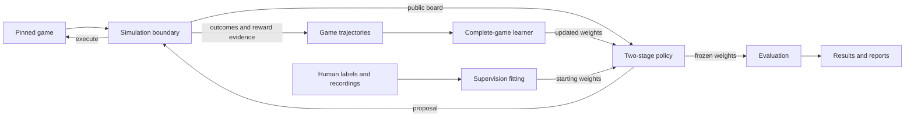
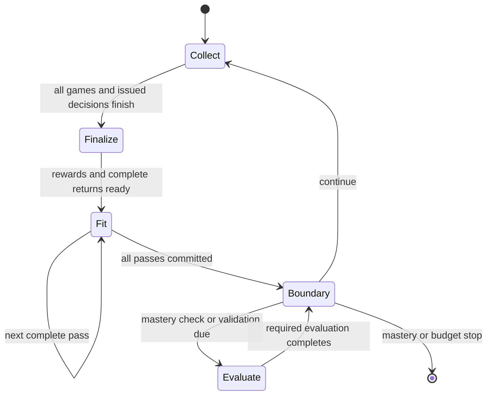

# System architecture

This project learns plant placement in a pinned Plants vs. Zombies simulator.
It has one stateless two-stage Transformer Q policy and one autonomous learning
framework. Human annotations and verified demonstrations can provide starting
weights for that same policy.

The project owns learning, reward interpretation and experimental evidence.
The separately installed game owns combat, legal actions and game rules.
Autonomous collection and fitting require CUDA with native BF16 support. CPU
simulation supports annotation, recording, baselines and reference checks.

## Components and data flow

| Component | Responsibility |
|---|---|
| Simulation boundary | Execute proposals, expose public boards and report actual outcomes |
| Policy and exploration | Choose an action category and location; manage collection-time exploration |
| Complete-game learner | Finalize trajectories, prepare targets and update the policy |
| Human supervision | Preserve labels and verified recordings; fit compatible initializations |
| Experiment control | Resolve settings, coordinate curriculum and budgets, validate progress and recover runs |
| Evidence and presentation | Evaluate frozen policies, preserve provenance and display actual execution |

The interaction loop produces experience; the learning loop consumes completed
games. Experiment control coordinates both. Evaluation supplies evidence from a
frozen policy, and viewers observe execution.

A single [training configuration](../src/pvz_rl/data/train.toml) supplies the
bundled task, model and learning settings. Commands resolve effective settings
and record them with source identities in their output artifacts. Hardware
profiles adjust execution. Installation verifies the separate game source pin;
experiments check the installed engine and rules.

## Public inputs and action decisions

The policy sees the current public board: plants, zombies, projectiles, mowers,
resources, card cooldowns and public progress counters. Both stages receive the
same normalized entity and global representation. Entity storage is bounded;
truncation is reported and global counts still describe the complete board.
Transport padding creates no actions or supervision.

Seeds, future spawn schedules, simulator snapshots, source identities and reward
ledgers remain private execution data. Annotation provenance and viewer history
also stay outside model inputs. The policy has no learned memory between decisions.

The first Transformer predicts values for wait, the eight plant species and dig.
For a usable non-wait choice, an independent conditional Transformer scores all
45 plots from the category and public board. Each stage has its own learned
parameters. Category choice uses its direct predictions; placement inference
runs only for requested board/category pairs.

Ordinary category selection includes resource- or cooldown-unavailable choices.
The simulation boundary checks category availability before attributing a failure
to placement, and can skip placement inference for an impossible category. Dig
requires a plant somewhere on the board. Once a category is available, every plot
remains a candidate, including occupied planting plots and empty digging plots.
The engine validates the resulting proposal.

At the default cadence, accepted actions and waits use the same ten-tick
decision interval. Rejected proposals execute wait for that interval
while retaining their proposal and rejection reason. The supported action-phase
mode instead applies accepted planting/digging immediately and advances a tick
on wait or rejection. Cadence is resolved consistently for CPU and CUDA adapters.

Collection can explore tile choices or commit to another plant species after an
accepted planting or a configured interval of continuous ordinary waiting.
Commitments wait for sun/cooldown availability, then attempt placement until
success or episode end. Success returns to ordinary collection. Rejection breaks
an ordinary-wait streak; commitment waits do not extend it. Exploration rates are
fixed within a cohort and decay with stage games. Evaluation and demonstrations
disable these collection exploration mechanisms.

## Learning from complete games

Training collects a fixed cohort of games with frozen policy weights. Finished
games remain paused until the entire cohort finishes. Only actual active
decisions enter trajectories; stable episode/action identities associate boards,
outcomes and reward evidence through storage and recovery.

Finalization combines terminal outcome, resource and living-plant asset changes,
damage, blocking, produced sun and mower expenditure. Mower costs use final reward
units independently of physical-value conversion. Cohort completion-time ranking
adjusts terminal rewards. Residual sun can add a win-terminal reward or penalize
each accepted ordinary wait in a loss according to its consecutive run length;
commitment waits and rejections are excluded. Complete undiscounted remaining
returns are then computed chronologically for each episode.

Credit attribution has a backend boundary. CPU/reference games and reconstructed
demonstrations can assign delayed owned effects to their originating placement.
The CUDA collector currently records aggregate effects on the transition where
they occur. Equal aggregate accounting therefore does not establish identical
placement-time targets.

Fitting routes each actual proposal to its responsible stage. Wait returns train
the category stage; accepted plant/dig returns train the selected tile. Impossible
categories and invalid tiles train only their respective stage toward a detached
target below that head's current minimum value. This target changes with the
current forward pass and leaves episode rewards and stored returns unchanged.
Accepted non-wait category values learn through consistency: the online tile
network chooses a candidate and an exponential-moving-average (EMA) reference
evaluates it.

The default schedule repeats five tile-only cohorts followed by one joint
category/tile cohort. Each cohort receives four complete fitting passes. Tile-only
cohorts update tile weights and tile EMA, preserving category weights and EMA.
Joint cohorts apply the full routed objective and category consistency. Every
pass covers its prepared cohort before one clipped optimizer update and the
corresponding EMA update commit.

Balancing uses cohort-wide populations. Fitting can retain representatives from
windows of repeated waits or identical invalid proposals; reward accounting and
complete returns retain every decision. Trajectories use bounded RAM with disk
spill and are released after their cohort is fitted.

## Human supervision and initialization

Annotation and demonstration workflows run independently of autonomous learning
and supply full-model weights for a fresh run. They can be composed by starting
demonstration fitting from annotation weights.

Annotations come from reachable simulator states. Separate action-category and
tile datasets retain public snapshots, model inputs, availability evidence and
human label sets. Pending, labeled and discarded records persist. Contradictory
labels for identical inputs are resolved together; revision checks protect edits.
A next-board generation failure preserves saved labels and supports retry.

Annotation fitting trains the selected stage while freezing the other. Exact
feasible-winner and absolute-bottom requirements on both training and validation
splits gate final publication. Once training first converges, fitting can enter
an L2 regularization phase while retaining the training split. Freshly reloaded
BF16 runtime weights must pass the same convergence checks before publication;
test results remain diagnostics. Atomic progress snapshots preserve resumable
work and can also supply fresh starting weights before convergence, including
before the first fitting pass.

Demonstrations require a complete natural win or loss. Reconstruction verifies
observations, proposals, outcomes, timing and replay identity, then reprices the
verified evidence under the selected reward settings without rewriting recordings.
Shared return fitting trains both stages, with demonstration ranking supervision.
Its own pass/time allowance and completed-pass publication boundary apply.

## Curriculum and evaluation

The teaching curriculum advances from easy games to mixed easy/standard games,
then a shared mix including hard games. Separate deterministic mastery cases and
residency criteria govern advancement. Stage changes apply to future resets and
preserve the ongoing run's learning state.

Under the default schedule, stage success triggers ordinary validation across
difficulties. Complete validation can select one shared best policy. Incomplete
required validation stays pending and blocks further updates. A run that reaches
its budget without qualifying validation can finish without a selected best policy.

Training, mastery, validation, final test and changed-scenario evaluation use
separate case pools. Evaluation freezes weights, disables exploration and performs
no fitting. Recorded CUDA traces are replayed and checked on CPU before publication;
this verification covers the selected recordings. Reports compare policies and
fixed baselines on paired scenarios. Research orchestration coordinates explicit
learner attempts, frozen evaluations and reports with restart journals.

## Durable state and recovery

| Artifact | Source and destination |
|---|---|
| Supervision datasets and recordings | Simulator/human evidence retained for review, reconstruction and reusable initialization |
| Portable model weights | Autonomous or supervised fitting outputs consumed by inference and fresh runs |
| Recovery checkpoints | Coherent autonomous run state consumed by resume, including unfinished experience |
| Annotation fitting progress | Weights, optimizer, split/settings identity, RNG and phase consumed by annotation resume or fresh initialization |
| Provenance and results | Effective settings, source identities, metrics and evaluation cases retained with run/report outputs |

Fresh initialization transfers compatible complete model weights and starts new
optimizer, curriculum, budget and random state. Autonomous resume restores the
simulator, unfinished trajectories, optimizer, online/EMA networks, exploration,
cohort/pass schedule and random state. Annotation progress has a separate resume
contract and cannot recover an autonomous run.

Compatibility checks validate engine identity, public representation, model
structure and the relevant learning/state contracts before collectors allocate.
A checkpoint ineligible for resume may still provide compatible starting weights.
Resume preserves saved learning settings; supported wait-trigger and passivity
setting refreshes take effect only at the next cohort, preserving the current
cohort's interpretation.

Saving stops new selection and finishes issued work before atomically replacing
the recovery checkpoint. A partial fitting pass restarts; committed updates are
not repeated. Temporary transfer, batching, compilation and graph caches rebuild
from authoritative state.

## Execution, diagnostics and presentation

GPU batching, compilation and bounded caches change execution while preserving
public inputs and learning semantics. Collection and fitting have separate
execution resources. Memory pressure can spill host storage or use bounded eager
fallbacks. Exhausted recovery or nonfinite learning values fail explicitly.

Viewers, journals, progress and hardware sampling observe actual execution.
Bounded presentation queues allow slow or failed viewers to be detached while
learning continues. Native/browser viewers consume public frames and diagnostic
decisions; the learner retains model and simulator ownership. Displayed training
rewards remain outside policy inputs and are refreshed after cohort finalization.

Read-only reward reports derive component accounting, action routes, fitting
compaction and warnings from saved settings and bounded log snapshots. They mark
unfinished data as provisional. Replay videos, plots and reports are derived
artifacts with export status separate from completed learning. Availability and
performance diagnostics establish workflow or execution evidence; gameplay quality
requires evaluation results.

## Further reading

- [Quick start](../README.md) for requirements, installation and commands.
- [Entity inputs](math/entity-inputs.md) for representation and attention details.
- [Sequential learning](math/sequential-training.md), [reward economics](math/training-objective.md)
  and [invalid-action attribution](math/invalid-action-penalties.md) for learning contracts.
- [Execution controls and diagnostics](math/training-throughput.md) for performance work.
- [Code and test ownership](../AGENTS.md#code-structure) for implementation navigation.
- [References](references.md), [iteration history](iteration.md) and
  [retained measurements](evidence/) for research attribution and evidence.
