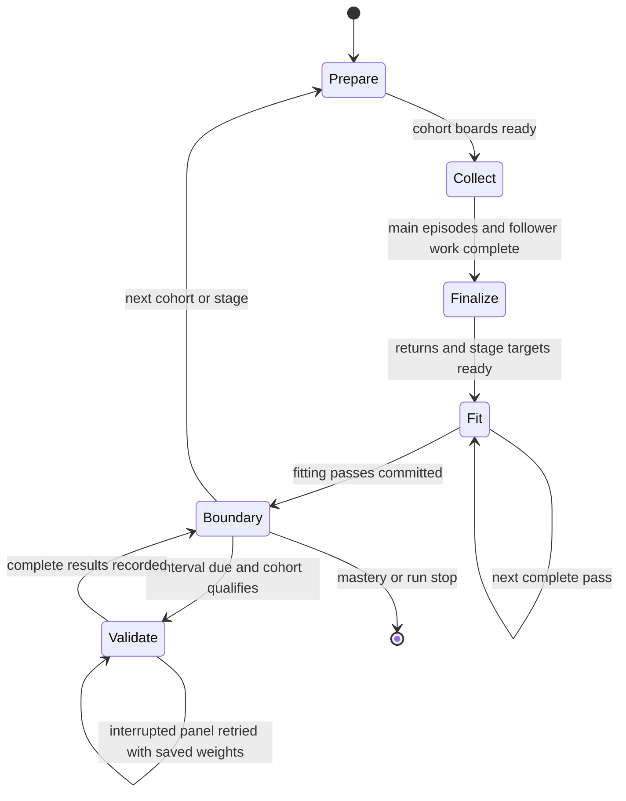

# System architecture

This project learns plant placement in a pinned Plants vs. Zombies simulator.
One stateless two-stage Transformer policy serves autonomous learning,
evaluation and human-supervised initialization. The project owns learning,
reward interpretation and experiment artifacts; the separately installed game
owns combat, legal actions and game rules.

Autonomous collection and fitting require CUDA with native BF16 support. CPU
simulation supports annotation, recording, baselines and reference checks.
Installation verifies the game pin without modifying its source checkout.

## Components and information flow

| Component | Responsibility and connections |
|---|---|
| Experiment control | Resolve settings and source identities; coordinate stages, budgets, validation and recovery |
| Simulation boundary | Execute policy proposals; expose public boards, actual outcomes and private accounting evidence |
| Shared policy runner | Apply independent species and conditional tile networks to public observations |
| Cohort learner and teaching pipelines | Turn completed experience, private labels and simulator comparisons into policy updates |
| Human supervision | Preserve positive tile annotations and verified demonstrations; produce compatible starting weights |
| Evaluation and presentation | Measure frozen policies and derive reports, charts, recordings and live views |

The [training configuration](../src/pvz_rl/data/train.toml) supplies task, model,
learning and demo-overlay settings. Stage settings resolve into the runtime
layout when loaded. Hardware profiles control execution resources. Effective
settings and engine, model and schema identities travel with saved run state.

Engine observations become normalized public entities and global features.
Executed proposals produce trajectories and reward evidence. Teaching pipelines
attach private targets or comparisons; fitting consumes the completed cohort
and updates weights. Evaluation freezes those weights, while presentation
consumes execution and result data.

## Public observations and action decisions

Both networks receive current public board facts: plants, zombies, projectiles,
mowers, sun, cards, cooldowns and public progress counters. Entity storage is
bounded; truncation is reported and global counts describe the complete board.
Seeds, future spawn schedules, snapshots, target identities, oracle labels and
reward ledgers remain private. The policy retains no learned state between
decisions.

The species network scores Wait, the eight plant species and Dig. An independent
tile network conditions on the chosen category and scores all 45 cells. The
shared runner applies the same decision semantics in collection and evaluation;
tile inference is needed only for usable non-Wait choices.

Category availability precedes tile validity: resource or cooldown failure
belongs to the species decision before placement is considered. Dig requires a
plant on the board. Occupied planting cells and empty digging cells remain
proposal candidates; the engine validates the selection. Rejections retain
their proposal and reason while advancing through configured wait behavior.
CPU and CUDA adapters share action cadence, legality and reward-conversion
contracts.

Normal collection can explore species through persistent commitments that wait
for resources and attempt placement until success or episode end. Tile exercises
use their supplied species. Evaluation disables collection exploration. Private
labels and simulator followers never replace the main policy's chosen action.

## Autonomous learning

Each cohort collects a fixed set of main episodes under frozen weights. Finished
episodes pause until the cohort completes. Stable episode and decision identities
connect observations, proposals, outcomes and accounting evidence through
storage and recovery. Only main episodes advance training budgets; oracle
rollouts, followers and validation have separate accounting.

Finalization combines terminal outcomes, resource and plant-asset changes,
damage, blocking, produced sun and mower expenditure. Cohort duration shaping
and configured endgame rewards contribute before complete remaining returns
are calculated. Repeated waits or invalid attempts may be compacted for fitting;
their original reward accounting remains intact.

Fresh runs use stage-specific teaching signals:

| Stage | Experience and fitting signal |
|---|---|
| Cherry Bomb | Prepared boards and exact source-attributed engine hits define successful tile sets; fitting increases total probability on each set |
| Cherry Bomb obstacle | Obstructed boards retain exactly one engine-verified legal hit; the same set objective teaches that tile |
| Attacker preparation | A supplied attacker uses conservative distance labels on mixed boards; a first-cell fallback can satisfy the task, with actual kills reported separately |
| Peashooter | Learner-visited planting attempts, including occupied rejections, receive prioritized visible-lane engine labels after collection; fitting uses column-decaying tile targets |
| Normal games | Legal plantings fork up to two same-species alternatives on the same board; outcomes teach pairwise tile preferences, while species/Wait and legal Dig retain complete-return fitting |

Bomb and attacker set objectives include all 45 outputs without prescribing a
probability split within the successful set. Configured bomb temperature
schedules use the completed cohort's attributed-hit rate and stay fixed across
fitting passes; saved scalar settings retain a constant temperature.
Peashooter labels test current visible threats without future spawns or further
planting. Covered threats permit lane balancing; otherwise undefended threatened
lanes take priority over endangered defended lanes.

Normal followers replay accepted main commands without policy calls or recursive
forks. Occupancy conflicts discard a follower; resource shortages queue commands
in order. Comparisons teach tile preferences without tile-max consistency
targets for species. Unavailable categories and invalid placements have distinct
fitting routes. Configured tile-only cohorts freeze species weights and their
EMA reference; joint cohorts also fit species. Complete fitting passes define
durable update boundaries.

## Curriculum and validation

Default progression is Cherry Bomb → Cherry Bomb obstacle → attacker preparation
→ Peashooter → easy → standard → shared normal games. Tile stages have separately
configured cohort sizes and independent episode budgets and validation clocks.
Each validates its own skill. Explicit fresh normal stages skip tile lessons.
Automatic progression preserves optimizer state; independently selected stages
finish at their own mastery gate. Legacy recovery retains its saved stage order
and combined-stage behavior.

At configured episode intervals, qualification uses authoritative outcomes from
the entire most recent fully fitted cohort, including attributed bomb hits.
Shortened cohorts and rolling statistics cannot qualify; a skipped check waits
another interval. Qualification permits validation and does not certify mastery.

Every validation samples fresh random seeds outside reserved splits and saves
the panel before execution. Interrupted panels remain pending against the same
weights and must finish before further fitting. Cherry Bomb and Peashooter must
strictly exceed their own configured validation thresholds; other fresh stages
require perfect validation. Normal advancement also respects residency
requirements and applies to future resets.

Under the default normal workflow, stage mastery triggers broader validation
across difficulties, which can select a shared best policy. Tile-stage mastery
is separate. Manual evaluation freezes the policy without fitting or followers;
its validation split also uses fresh random cases, while development, test and
changed-scenario splits retain configured seeds. Baseline comparisons and
selected CPU-verified CUDA recordings provide additional evidence.

## Human supervision and initialization

The annotation studio samples reachable boards and records positive tile sets
for an available plant. Pending, labeled and discarded records persist;
identical-input conflicts are resolved together with revision checks. Manual
action-category labels and absolute-infeasible tile labels are unsupported.

Annotation fitting freezes species and trains tiles with a top-1 hinge.
Publication requires every greedy choice on both training and validation splits
to belong to its positive set, verified again after reloading saved weights.
An L2 phase can support validation convergence after training converges; test
metrics remain diagnostic. Atomic progress snapshots support annotation resume
or compatible initialization before convergence.

Demonstration initialization requires a complete natural win or loss.
Reconstruction verifies observations, proposals, timing, outcomes and replay
identity, then reprices evidence under selected reward settings. Return fitting
and demonstration ranking train both stages. Annotation weights can seed
demonstration fitting, and either workflow can initialize autonomous learning.

## Durable state and artifact lifecycle

| Artifact | Source and destination |
|---|---|
| Annotations and demonstrations | Human/simulator evidence retained as reusable supervision inputs |
| Recovery checkpoints | Coherent unfinished autonomous state consumed by resume |
| Annotation fitting progress | Supervised weights, optimizer, split identity and phase consumed by annotation resume or weight transfer |
| Portable weights | Completed or compatible saved models consumed by inference and fresh initialization |
| Results and visualizations | Settings, provenance, metrics and evaluation evidence transformed into reports, charts and recordings |

Autonomous resume restores simulators, unfinished experience, optimizer,
online/EMA weights, exploration, cohort/pass progress, pending teaching work,
validation panels and random state. Compatibility checks validate model,
objective, public schema and engine identities before collection. Saved learning
settings remain authoritative; supported execution and explicit resume-refresh
settings are handled separately. Annotation progress has its own resume contract.

Fresh initialization transfers compatible weights into new optimizer,
curriculum, budget and random state. Legacy non-search recovery preserves its
saved objective; retired search recovery permits weights-only transfer. Formats
are validated explicitly rather than silently migrated.

Saving drains issued decisions and atomically replaces recovery state. Partial
fitting passes restart; committed updates are never replayed. Unfinished
speculative preparation is regenerated, with seeds and outcomes committed only
when consumed. Temporary execution caches rebuild from authoritative state.

Successful autonomous completion retains portable final weights and generated
visualizations, then removes owned recovery outputs. Interrupted, failed,
time-limited or otherwise incomplete runs retain recovery artifacts. Completed
annotation and demonstration fitting retain portable weights and preserve
supervision inputs. Portable completion weights start fresh runs and cannot
resume autonomous state.

## Execution and presentation

Persistent CPU preparation workers, bounded CUDA oracles, batching, compilation
and CUDA graphs share explicit host/device memory budgets. Trajectories and
private roots can spill to owned disk storage. Speculative preparation overlaps
fitting. Validation releases idle scratch and graph allocations while preserving
workers and speculative seed state. Execution mechanisms preserve public inputs,
labels and learning semantics.

Live viewers and diagnostics observe execution while the learner owns policy
and simulator state. Slow presentation can detach through bounded queues.
Training rewards stay outside policy inputs and refresh after finalization.
Validation checks and completion refresh reports, including skipped checks and
mastered stages. Offline reports can be generated without policy inference;
recordings and other exports have separate completion status. Workflow checks
establish availability and performance; gameplay quality comes from evaluation.

## Further reading

- [Quick start](../README.md) for installation and commands.
- [Entity inputs](math/entity-inputs.md) for representation and attention details.
- [Sequential learning](math/sequential-training.md), [reward economics](math/training-objective.md)
  and [invalid-action attribution](math/invalid-action-penalties.md) for detailed learning contracts.
- [Execution controls](math/training-throughput.md) for resource and diagnostic details.
- [Code and test ownership](../AGENTS.md#code-structure) for implementation navigation.
- [References](references.md) for research attribution.
