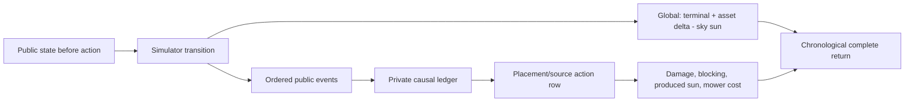
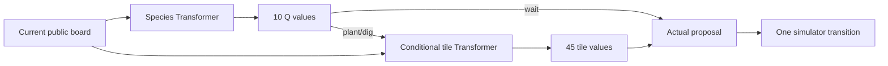
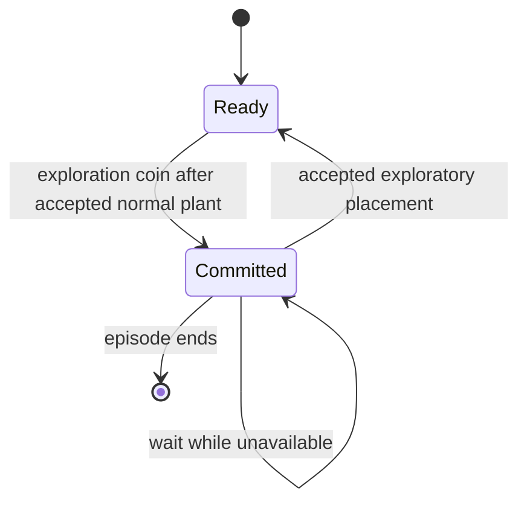
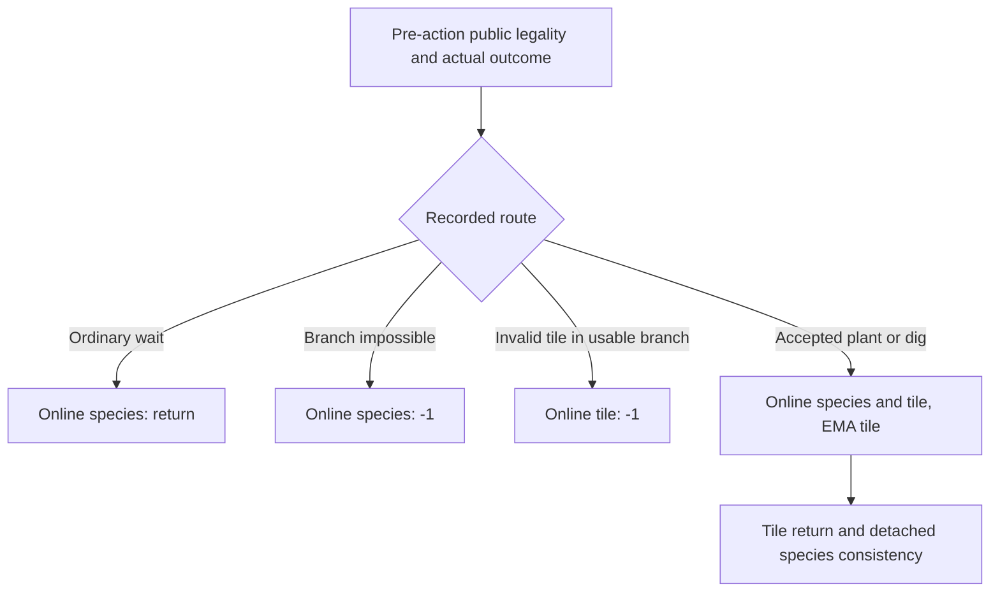
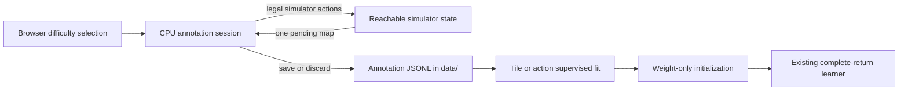
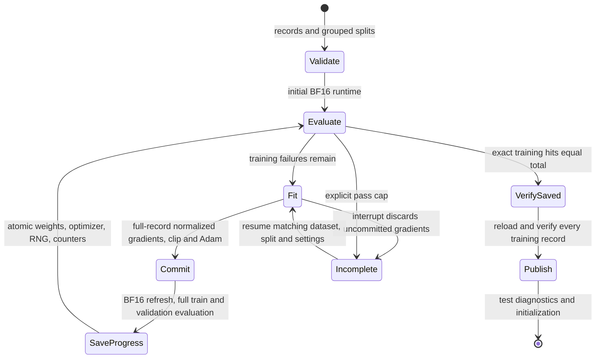
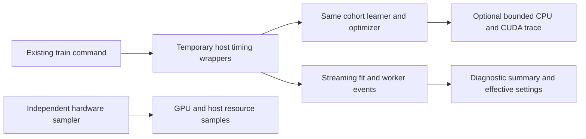
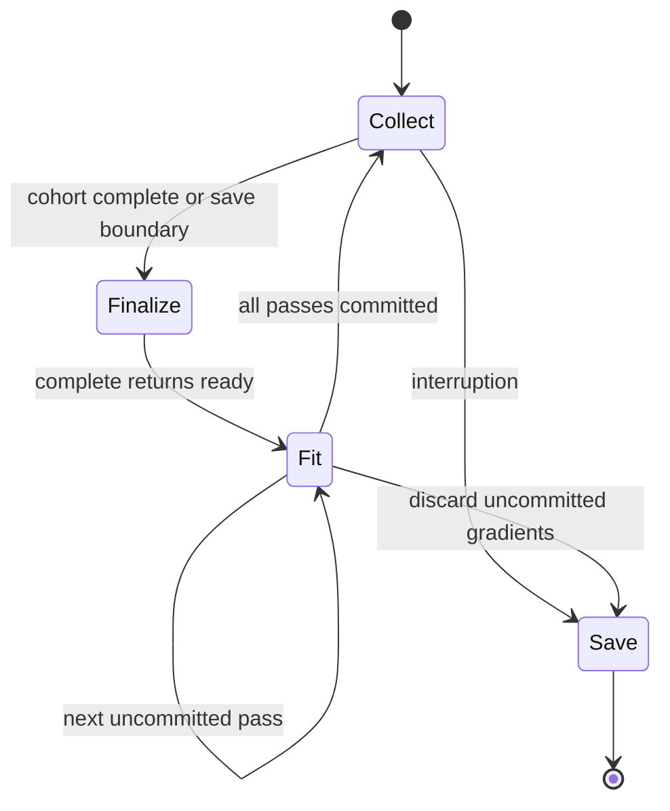
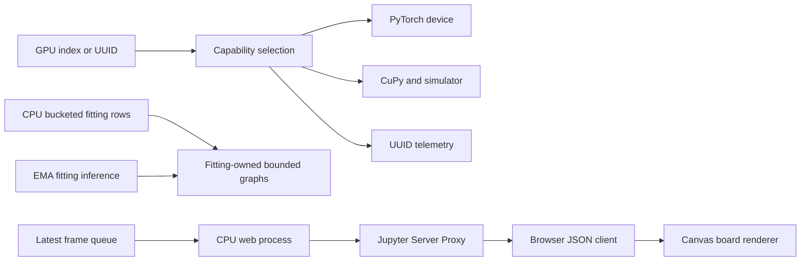

# System architecture

The project trains a stateless two-stage Q policy against a pinned CUDA
simulator. Every decision reads the current public board; no LSTM, event memory,
frame stack or counterfactual simulator is part of the policy or collector.

## Responsibilities

| Area | Responsibility |
|---|---|
| Environment adapters | Public entities, timing, action outcomes and reward ledgers |
| Two-stage policy | Species/wait/dig Q values and conditional tile Q values |
| Exploration controller | Tile randomness and persistent alternative-species commitments |
| Cohort learner | Collection, complete returns, balanced losses and EMA updates |
| Storage/transport | Canonical rows, ragged entities, RAM/disk spill and prefetch |
| Checkpoints | Contract validation, FP32 masters, BF16 EMA and atomic recovery |
| Monitoring/presentation | Host-side progress, diagnostics and read-only journals |

Seeds, schedules and simulator snapshots stay in execution state and never enter
policy inputs. `src/pvz_rl/data/train.toml` is the sole parameter source.

## Reward and causal credit flow

The global channel contains only the terminal outcome and the change in
`sun + living-plant value`, with sky-generated sunlight excluded. The ordered
event stream retains plant IDs, projectile source IDs and environment/episode
identity privately. Plant/projectile damage, lethal damage, Sunflower income,
Chomper swallowing and authoritative bites are credited to the originating
placement action; mower activation has no placement origin and is charged to its
transition. `PlantRemoved` is processed after earlier events in the same stream.
Initial plants and events without an origin are reported as unattributable and
cannot leak IDs into observations. The trajectory buffer can apply host source
credits retroactively before returns are finalized. CUDA emits the same six
learning components and private aggregate accounting; detailed device source
rows are optional adapter data.

Wall-nut uses a positive signed blocking coefficient while ordinary plant bites
are negative. A Wall-nut can therefore earn local blocking value while losing
asset health, but terminal defeat remains globally negative. Proximity and
victory-time values remain diagnostics and are not learning targets.

PowerShell and Bash bootstrap tools install the same pinned CUDA environment.
They share archive/hash verification, install the game non-editably and never
change its checkout. A missing commit or mismatched manifest fails installation;
the Bash entry point removes its temporary source archive even on failure.
See [installation](../README.md#installation).

## Decision flow

The species stage has width 128, four layers and eight heads. The tile stage has
width 192, six layers and twelve heads. Their parameters are independent. The
tile stage receives the selected branch, the same current board and 45 spatial
queries. Plants use empty tiles, dig uses all tiles, and a full-board plant
keeps the tile-zero rejection fallback. Sunlight and cooldown do not hide
branches. A rejected action records its proposal and advances one tick; an
accepted plant or dig advances zero ticks.

Both stages run with BF16 parameters and activations during collection,
evaluation, demonstrations and fitting. The online policy keeps unregistered
FP32 master parameters, and Adam owns only those masters and FP32 moments.
After each committed fit pass, masters are copied to the BF16 runtime model and
the BF16 EMA teacher is updated. Checkpoints serialize FP32 online masters,
FP32 optimizer state and BF16 EMA state.

## Exploration and collection

Tile exploration decays from 50% to 1%, and accepted normal planting can start
a uniformly selected alternative-species commitment from 10% to 1%. Both
schedules decay over 10,000 stage games, remain fixed within a cohort and reset
on stage changes. Commitments issue ordinary waits until the species is
affordable, cooled down and placeable. Successful committed placements clear the
commitment; they do not recursively trigger another commitment.

An active-batch plan packs unfinished original slots into public-width buckets,
then restores results to canonical slots. Finished slots are inactive and never
refilled. Padding carries no state, RNG, supervision or storage evidence. Real
environments continue immediately after planting: there is no probe queue,
source bank, auxiliary lane or post-plant drain.

## Learning and storage

Every actual decision is appended with its public observation, proposed action,
acceptance, duration, reward, exploration provenance and stable original slot.
Complete returns are computed chronologically per episode, while inactive slots
and capacity gaps contribute nothing. Entity-bucketed and route-separated flat batches are prefetched
through the existing double buffer and reused across all fitting passes; padding
is excluded from losses and denominators.

Compiler caches and CUDA captures belong to individual encoders. Fitting uses
phase-local code objects and bounded static shapes; collection uses its separate
LRU. Quiescent phase changes release fitting captures and renew only the owner's
compiler cache, without changing global limits or policy inputs.

Ordinary wait regresses the complete remaining return through species. Accepted
plant/dig regresses the proposed tile through the conditional stage; detached
online tile selection and BF16 EMA evaluation supply species consistency. A
shared classifier consumes full pre-action public legality and the actual
outcome. Impossible branches train species to -1; bad tiles within usable
branches train only the proposed tile to -1. The trajectory retains the route,
branch usability and rejection reason separately from proposal/execution.
Rejected proposals execute ordinary wait, and penalty audit fields stay zero.
Fitting-only -1 targets never enter rewards or chronological returns.

CPU row plans accompany batches through the existing pinned double buffer.
Species-only routes skip both tile networks; tile-only routes skip species and
EMA. Accepted/rejected wait/plant/dig regression uses whole-cohort denominators;
EMA consistency uses accepted plant/dig counts only. Four autonomous passes and
twenty demonstration passes commit one optimizer step per pass, then update
EMA with decay 0.95. Graph ownership, fencing and allocation recovery are shared.

## Reachable-state annotation warm-start

The annotation path is independent of a running training process:

`annotate` owns one pending map at a time. Selecting `easy`, `standard`,
or `hard` starts a fresh simulator episode and advances it through legal actions
for a seeded uniform limit of 0–20,000 actions. Planting attempts are separated
by random 500–1,500-step intervals. Every interval draws equally from wait and
all eight configured species before checking availability. Cooldown, insufficient
sun, absent cards, no legal plots or the configured eight-plant cap turn the
selected plant into wait without a redraw. Usable choices select a random legal
plot; the shared availability check also validates snapshot annotation cards.
Tile mode retains only running endpoints with a usable plant card and legal
plots. Action mode retains any running endpoint because it labels the complete
wait/plant/dig decision and has no sampler-selected current action. Finished
games are discarded and retried within bounded attempts. Both batch generation
and the live session use this same sampler. Each record keeps the rich
public board and canonical `entity_v1` encoding, plus card availability, cost,
sun, cooldown, and engine-legal tiles. Pending records are persisted in
`data/tile-annotations.jsonl`; a restart resumes the same map. Saving or
discarding resolves the record atomically and immediately generates the next map.
A staged difficulty change applies only to that next map. The browser shows the
complete sun/card/entity/mower/wave state and paints a set by holding the left
mouse button and dragging across tiles. Discarded states remain audit records
and are excluded from fitting.

In action mode, the same Canvas board exposes each rendered plant card as a hit
target. The active feasible, absolute-infeasible, or erase mode determines what
a card click does; locked automatic absolute labels cannot be changed. Wait and
dig have compact synchronized toolbar controls because they have no plant card.
The toolbar does not duplicate plant actions as HTML buttons, and no random
sampler action is shown as the current target. Card hit testing uses the board's
design coordinates, so browser resizing and high-DPI displays do not change the
selected action.

At startup, completed labeled rows are grouped by plant type and their canonical
encoded entities/globals. A group with no common feasible tile is a duplicate
conflict. Conflict review takes priority over map generation and shows the first
group directly in the browser. One corrected label set is committed atomically to
all group members, then the next group is shown. Any pending map remains durable
and is resumed after the final conflict. **Save and exit** commits only the
currently displayed map or conflict group and requests an asynchronous server
shutdown.

History navigation is local to each browser request, rather than a shared server
cursor. Previous/Next can select any persisted map while the single pending map
remains unchanged. Saving a completed record updates only its labels/status and
increments its annotation revision; it never calls the sampler. Existing records
without a revision start at zero. Every edit supplies the revision it loaded so
an obsolete tab cannot overwrite newer labels. Reads and mutations share the
session lock, and browser request IDs reject stale responses. Difficulty changes
preserve the displayed record and its draft. JSONL records remain the source of
truth; manifest counts and digest refresh after each saved edit.

```mermaid
stateDiagram-v2
    [*] --> Pending: Generate or resume
    Pending --> Pending: Save/discard and generate next
    Pending --> Review: Previous
    Review --> Review: Previous/Next or save/discard in place
    Review --> Pending: Return to current or Next
    [*] --> Conflict: Contradictory duplicate labels
    Conflict --> Conflict: Save corrected group; show next
    Conflict --> Pending: Queue empty; resume pending map
    Conflict --> [*]: Save and exit
```

Reviewing can restore a discarded record to labeled status. Closing the browser
discards only unsaved edits after a warning; restart resumes the pending map.
Generation failures do not prevent reviewing and correcting completed maps.

The sampler does not edit engine health, sun, cooldowns, or mower state. These
facts evolve through simulator actions, and later endpoints include combat and
spent mowers. Zero and other early limits remain valid preparation states. The
source records the sampled action-step count separately from simulator ticks.

Tile mode labels all 45 query outputs; action mode labels the ten species/action
outputs (`wait`, eight plants, `dig`). Each record has an unordered feasible set
and optional unordered absolute-bottom set. The top-1/bottom-k margin objective
requires one feasible label to win and all absolute labels to occupy the lowest
slots, without ordering labels within either set. Automatic simulator-impossible
labels are persisted and locked in the browser; new action records also start
Dig as an editable absolute-infeasible label while retaining raw dig availability
for audit. Tile fitting freezes species; action fitting freezes tiles. Both can
start from random weights. The optional
`initialize-demo --init-from` loads either artifact and creates fresh
optimizer/EMA state. Runtime gameplay masks remain unchanged. Empty labels,
overlaps, missing automatic labels and contradictory identical model inputs fail
before fitting. Source metadata, seeds and discard reasons never enter model
inputs.

The on-demand annotator uses a system-entropy session seed when `--seed` is
omitted, while each record stores its actual simulator seed for audit and replay.
An explicit seed restores deterministic sampling. Formal fitting compacts only
consecutive invalid proposals within each environment episode: identical
action/route/reason runs are split into 100-row windows and their first rows are
retained. Complete-return finalization still uses the full trajectory; fitting
denominators and encoder workload use the retained representatives.

Passes default to unlimited; validation never determines completion. Progress is
separate from the portable weight-only artifact and metrics stream to JSONL.
Only freshly verified convergence publishes an initialization; initially correct
weights can qualify at zero passes. Exact training accuracy says nothing by
itself about unseen boards or equal-game learning performance.

## Optional fitting diagnostics

The diagnostic script in `tools/` forwards the normal training arguments and
records fitting startup, CPU preparation, compilation/capture, loss/backward
and weight updates without replacing any training operation. Chunk metadata
uses host records and tensor shapes; the lightweight path issues no new CUDA
events or waits. The existing independent hardware sampler accepts optional
host detail collection for thread CPU, process I/O and container quotas.
Raw samples/events stream to a separate unused directory, with a bounded set
of slow chunks in the summary. Temporary wrappers are restored on exit.

The optional profiler captures one finite window counted by fitting data batches.
It can perturb execution and add synchronization, so its trace explains the
timeline while lightweight samples describe ordinary utilization. Unsupported
resource facts and trace failures are reported without dropping samples or
changing fitting. Host spans overlap and CUDA-event pass duration includes idle
gaps; neither is an estimate of GPU busy time. See the
[diagnostic workflow](math/training-throughput.md#diagnose-cloud-fitting-stalls).

## Recovery and failures

Saving and interruption preserve only coherent actual-game state. An unfinished
fit pass discards gradients; a committed pass is never repeated. Runtime maps,
prefetch workers, fitting spools and graph captures rebuild after recovery.
BF16 support is checked before simulator allocation. Nonfinite BF16 loss or
gradients fail explicitly; only bounded memory reductions may retry. Old
probe-enabled, FP32-runtime, partial-BF16 and incompatible contracts are
rejected before allocation for resume. Structurally compatible previous
BF16-master weights remain available for inference and fresh initialization;
execution caches rebuild and annotation optimizer state is never transferred.

Demonstration replay verification checks historical facts and reprices rewards
under current settings without rewriting recordings. Evaluation disables both
exploration mechanisms and performs no fitting. Curriculum mastery probes are
evaluation controls only; they are unrelated to counterfactual gameplay.

## Device portability and browser viewing

GPU names are matching hints, not a model whitelist. Any installed native-BF16 NVIDIA device can use `generic-bf16` or a user-defined TOML profile. Graphs, device identity and execution settings are rebuilt for the destination GPU; model weights retain the existing architecture and compatibility contract. The browser process consumes bounded latest-frame packets and sends the existing selection/history commands, so a slow browser cannot block collection or fitting. Web training uses an ephemeral loopback port by default; `--viewer-port` can reserve a fixed loopback port for cloud forwarding.

The browser-side renderer consumes only the JSON public observation contract.
It normalizes empty or partial frames before drawing and keeps the raw frame and
learning settings behind expandable diagnostics. Canvas rendering is procedural
and portable; it intentionally does not import the simulator or create a GPU
context in the browser.
