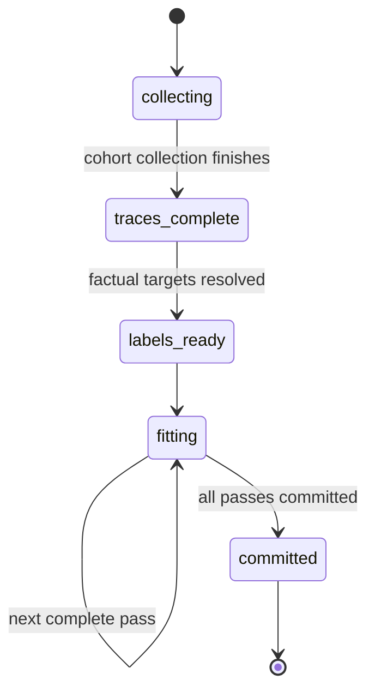

# System architecture

This project learns sequential plant-placement decisions in a pinned Plants vs.
Zombies simulator. One stateless policy serves autonomous learning, evaluation
and initialization from human demonstrations. The project owns observations,
learning, reward interpretation and experiment artifacts; the separately
installed game owns combat, legal actions and game rules. Installation verifies
the engine pin without modifying its checkout.

Autonomous collection and fitting require CUDA with native BF16 support. CPU
simulation supports human recording, replay verification, inference, baselines
and reference checks. Demonstration fitting can run on CPU or CUDA.

## Components and information flow

| Component | Responsibility and connections |
|---|---|
| Experiment control | Resolve settings and compatibility identities; coordinate stages, budgets, validation and recovery |
| Simulation boundary | Execute proposals; expose public boards, outcomes and private reward evidence |
| Shared policy | Encode a public board once; read action values and condition spatial tile/reach predictions on an action category |
| Cohort learner and automatic teachers | Turn completed experience, factual traces and stage targets into weight updates |
| Demonstration pipeline | Record human play, verify its replay and fit compatible starting weights |
| Evaluation and presentation | Measure frozen policies and derive reports, charts, recordings and live views |

The [training configuration](../src/pvz_rl/data/train.toml) supplies model,
learning, stage and demo-overlay settings. Stage settings resolve once into the
runtime layout; hardware profiles control execution resources. Run commands
select a fresh run, compatible initial weights or recovery state. Human recording
supplies a transition archive, manifest and native game replay.

Simulator observations become normalized public entities and global features.
Policy proposals produce executed or rejected actions, trajectories and private
accounting evidence. Finalization derives returns and teaching targets before
fitting updates the policy. Frozen evaluations feed progression and policy
selection. Saved weights serve inference or fresh initialization; recovery
restores unfinished work; presentation transforms run evidence into reports.

## Public observations and decisions

Inputs contain current public board facts: plants, zombies, projectiles, mowers,
sun, cards, cooldowns and public progress counters. Entity storage is bounded;
truncation is reported and global counts describe the complete board. Seeds,
future schedules, identities, snapshots, target sets, traces and reward ledgers
remain private.

A shared Transformer encodes the board once within each decision or fitting
call. Its action readout scores ten categories: Wait, eight plant species and
Dig. For a usable non-Wait category, an action-conditioned cross-attention
decoder queries all 45 cells; its features feed tile Q values and lane-reach
predictions. Wait and unavailable categories skip decoding. No feature cache or
learned state persists across decisions.

Category availability precedes tile validity: resource or cooldown failure is
attributed before placement is considered. Dig requires a plant somewhere on the
board. All cells remain candidates, including occupied planting cells and empty
digging cells; the engine validates the chosen cell. Rejections preserve their
proposal and reason while following configured wait behavior. CPU and CUDA
adapters share cadence, legality, physical outcome and reward-conversion
contracts.

Normal collection explores categories through persistent commitments that can
wait for resources and attempt placement until success or episode end; tile
choices stay greedy. Preliminary exercises supply the category being taught.
Private labels supervise fitting without replacing the learner's tile choice.
Evaluation uses the greedy policy without collection exploration.

## Cohort learning and automatic teaching

Each cohort collects a fixed set of episodes under frozen weights; finished
episodes pause until collection completes. Stable episode/decision identities
connect observations, outcomes and private evidence through storage and recovery.
Only real completed training episodes advance episode budgets and validation
clocks; preparation, oracle work and validation are accounted for separately.

Finalization combines terminal outcomes, resource and plant-asset changes,
damage, blocking, produced sun and mower expenditure with cohort-level shaping.
Returns discount elapsed simulator ticks. Wait/rejection compaction and fitting
weights preserve original accounting. Unavailable categories and invalid cells
have distinct fitting routes.

| Stage | Experience and fitting signal |
|---|---|
| Cherry Bomb | Prepared boards and source-attributed engine hits define successful tile sets; cross-entropy increases their combined probability across all 45 outputs |
| Cherry Bomb obstacle | Obstructed boards retain exactly one engine-verified legal hit; the same set objective teaches its placement |
| Attacker preparation | One of four supplied attackers uses conservative distance targets without candidate rollouts; fallback correctness and attributed kills are reported separately |
| Peashooter | Learner-visited planting attempts receive prioritized visible-lane engine targets and column-decaying cross-entropy |
| Normal games | Action and tile Q returns train jointly with factual visible-zombie reach prediction |

Bomb exercises use no exploration or search. Bomb/attacker objectives include
occupied cells; their temperature follows completed-cohort accuracy and stays
fixed across passes. Peashooter uses easy waves, disabled mowers and configured
sky-sun scaling with saved countdowns preserved. Its teacher checks global
coverage, then undefended threatened lanes, then endangered defended lanes.
Lane checks exclude future spawns and further planting.

Preliminary stages update shared/tile parameters while leaving action-readout
parameters and their exponential moving average (EMA) untouched. Shared updates
can still change action predictions. Normal cohorts jointly update the model,
using four complete passes in the bundled settings. EMA updates cover only
trained parameter groups. Normal learning uses main trajectories without
follower rollouts or tile-max action consistency; demonstrations retain their
separate objectives.

## Factual visible-zombie reach

For each usable non-Wait decision in normal collection, private tracking fixes a
target set of active, non-headless zombies retained in that public observation.
Labels describe the furthest column toward home reached by any of those zombies
in each lane during the actual continuation. Root positions and movement between
decisions count; later spawns and movement after a zombie's engine defeat do
not. Tracking stops at episode termination or cutoff.

The decoder predicts one of ten reach categories per lane: columns 1–9 or outside
the board. Lanes without eligible targets have no loss. Cross-entropy averages
first over eligible lanes, then equally over eligible decisions. Reach is separate
from reward and mastery; a zero reach-loss weight disables its gradient.

The private lifecycle makes label readiness and durable fitting explicit:

Owned, guarded CUDA hooks capture identity and movement evidence without extra
environments, policy calls or hot-loop host synchronization. Private storage
shares resource budgets. Missing identities, tracker overflow and storage
failures retain recovery rather than substituting labels. Target membership,
traces and label progress survive interruption.

## Curriculum and validation

Fresh progression is Cherry Bomb → Cherry Bomb obstacle → attacker preparation
→ Peashooter → easy → standard → shared normal games. Preliminary stages retain
independent cohort/resource sizes, episode budgets and validation clocks; normal
progression has separate residency and mastery state. Explicit normal stages
start directly; an explicitly selected stage can stop at mastery. Automatic
progression preserves optimizer state and changes future resets. Resume
preserves saved stage orders and counters.

At configured episode intervals, authoritative success across the entire most
recent fully fitted cohort must strictly exceed the qualification threshold
before validation can launch. Shortened cohorts cannot qualify; skipped checks
wait another interval. Qualification permits validation, while mastery requires
its separate result.

Every validation samples fresh random seeds outside reserved splits and saves
the panel before execution. Interrupted panels retry against the same weights
before further fitting. Cherry Bomb and Peashooter must strictly exceed their
configured mastery thresholds; other fresh stages require perfect validation.
Normal advancement also respects residency requirements. Default normal stage
mastery triggers broader evaluation across difficulties to select a shared best
policy.

Validation is greedy, without exploration, scratch labeling or reach-loss
updates. Manual evaluation also freezes the policy; its validation split uses
fresh random cases, while development, test and changed-scenario splits retain
configured seeds. Baselines and CPU-verified CUDA recordings provide additional
evidence.

## Human demonstrations

Initialization requires one complete natural win or loss with matching
engine/schema identities and replay integrity. Reconstruction verifies
observations, proposals, timing and outcomes, then reprices reward evidence
under the selected learning settings.

Return fitting and demonstration ranking train the shared policy under
demonstration-specific objectives, without reach supervision. Complete fitting
passes publish initialization weights and verification/learning reports.
Compatible weights can seed further demo fitting or fresh autonomous learning.
Manual annotation, its studio, dataset workflow and annotation fitter are
removed; existing user datasets and recordings remain preserved.

## Recovery, execution and artifacts

| Artifact | Source and destination |
|---|---|
| Demonstration archive, manifest and replay | Human/simulator evidence retained for verification and initialization |
| Recovery checkpoint | Coherent unfinished run state consumed by autonomous resume |
| Portable weights | Compatible models consumed by inference or fresh initialization |
| Reports, charts and recordings | Run/evaluation evidence presented for inspection and comparison |

Resume restores simulators, unfinished experience and labels, optimizer state,
online/EMA weights, exploration, cohort/pass progress, pending validation and
random state. Saved learning settings remain authoritative; supported execution
changes and explicit setting refreshes are handled separately. Compatibility
checks enforce model, objective, public schema and engine identities. Older
model/objective families cannot initialize or resume this architecture; no
weight conversion is defined.

Fresh initialization transfers compatible weights into new optimizer,
curriculum, budget and random state. Saving drains issued decisions and
atomically replaces recovery state. Partial fitting passes restart; committed
updates are never replayed. Speculative preparation regenerates unfinished work
after resume and commits seeds only on consumption. Execution caches rebuild
from authoritative state.

BF16 runtime parameters and activations serve inference and fitting; FP32 master
weights and optimizer state preserve updates. Preparation workers, bounded
oracles, batching, compilation and CUDA graphs share host/device memory budgets.
Trajectories and private evidence can use owned disk storage. Preparation can
overlap fitting; validation releases idle scratch/graphs while preserving
workers and speculative seed state.

Viewers and diagnostics consume execution data while the learner owns policy
and simulator state; bounded queues let slow presentation detach. Finalization
refreshes rewards and factual reach. Views distinguish predicted penetration
from factual outcomes and lanes without targets. Validation passes, skips and
completion refresh reports; offline reports require no policy inference.

Successful autonomous completion retains portable final weights and generated
visualizations, then removes owned recovery outputs. Interrupted, failed,
time-limited or otherwise incomplete runs retain recovery. Portable completion
weights start fresh runs and cannot resume autonomous state. Demonstration
inputs remain reusable independently of fitted weights. Workflow checks
establish availability; gameplay quality comes from evaluation.

## Further reading

- [Quick start](../README.md) for installation and commands.
- [Code and test ownership](../AGENTS.md#code-structure) for implementation navigation.
- [References](references.md) for research attribution.
